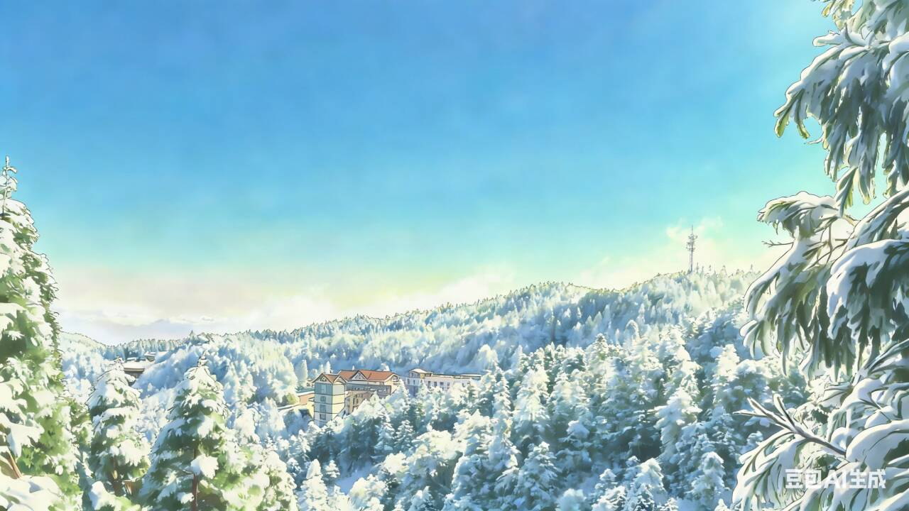

# 关于

<figcaption>封面图：来自小石头在明月山拍摄，使用AIGC工具适当修改</figcaption>

## 这里是哪里 

Hi~ 这里是ZhX的个人博客，主要分享一些计算机、生活相关的知识、体验或感悟。

## 自我介绍 

我是一名已经退役了的OIer，喜欢吃土豆和榴莲（如果要邮寄的话建议寄榴莲给我~），
还有各种好吃的好吃的（没错我是个吃货）。

至于身高体重……我现在166.7cm，68kg。

喜欢使用Linux，讨厌Windows~（万恶的Windows滚开啊～～～）~，爱好编程和看书。

## 联系方式

| 平台 | 地址 |
| :---: | :---: |
| 邮箱 | [` `zhx589@outlook.com](mailto:zhx589@outlook.com)|
| QQ | [` `2029837068](http://wpa.qq.com/msgrd?v=3&uin=2029837068&site=qq&menu=yes) |
