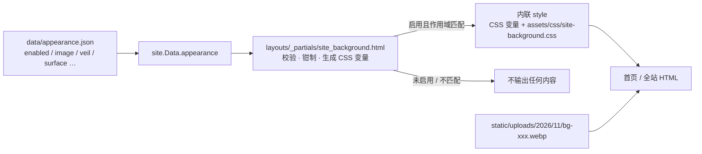
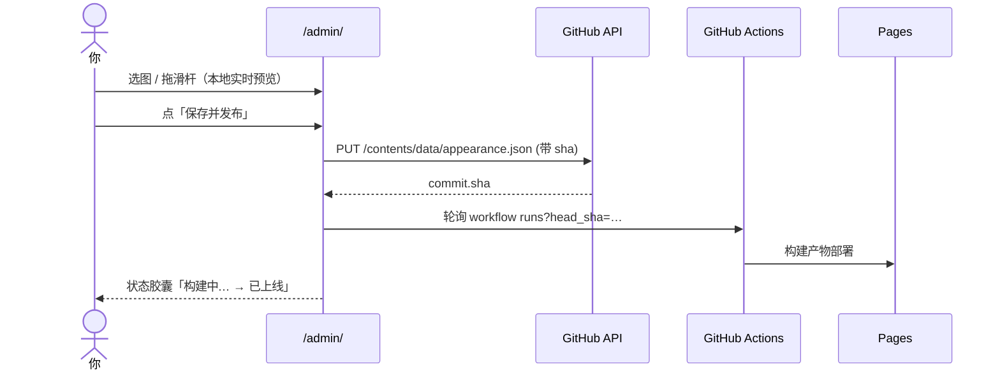
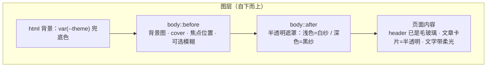

# 首页背景图（可在后台随时更换）设计方案

> 状态：待你拍板后交给执行方落地
> 版本：v1.1（修正深色模式 `.list` 特异性问题，见 §5 R9 与 §8.3）
> 目标仓库：`/data/ZhX-Blog`（Hugo 0.168.0 + PaperMod + 纯前端 GitHub 后台）
> 本文最后一节「实施交接」是执行方直接照做的那一版；前面的章节解释为什么这么做。

---

## 0. 一页结论（TL;DR）

**能加，而且可以做到「在后台选图 → 保存 → 等构建 → 首页就变了」，不需要改代码、不需要动主题文件、不需要重写 `hugo.toml`。**

推荐做法：

1. 新增唯一配置源 `data/appearance.json`（Hugo 原生 `data/` 目录，仓库里已有 `data/bilibili/` 的先例）；
2. 新增一个模板片段 `layouts/_partials/site_background.html`，从 `site.Data.appearance.background` 读出开关、图片、遮罩、模糊等参数，**只在启用且作用域匹配的页面**输出一段内联 `<style>`（CSS 变量 + 样式）；
3. 新增 `assets/css/site-background.css` 存放真正的样式（图片层、遮罩层、玻璃卡片），由上面那段 `<style>` 内联进去，**功能关闭时一个字节都不输出**；
4. 后台新增一个「外观」页：选图（复用现有媒体库/上传）、拖两个滑杆（遮罩强度、卡片不透明度）、切换作用范围、**本地实时预览**，保存时用现有的 `putFile` 写 `data/appearance.json`，再复用现有的 `pollRun` 显示构建结果。

改动量：新增 3 个文件、改 3 个文件（`extend_head.html`、`admin.js`、`admin.css`），**不动主题、不动 `hugo.toml`、不动部署工作流**（`data/**` 本来就在触发路径里）。

---

## 1. 背景与目标

### 1.1 用户诉求的原话拆解

- 「主页加一张背景」→ 视觉上要有图，且不能毁掉现在黑白灰 + 毛玻璃的阅读体验；
- 「我可以方便更换」→ 换图不能是改 CSS / 改模板 / 手动传文件再 PR，应该是后台里点几下；
- 「记得集成到后台里」→ `/admin/` 里要有入口，和现有「文章 / 页面 / 标签 / 媒体 / 设置」一致的心智模型。

### 1.2 目标（In scope）

| # | 目标 | 可验收的判定 |
|---|---|---|
| G1 | 首页有一张全屏背景图 | 打开 `/` 能看到图，页面内容压在上面且可读 |
| G2 | 后台可视化更换 | `/admin/#/appearance` 可换图、调遮罩、开关，保存后触发构建 |
| G3 | 零回归 | 关闭开关后，首页/文章页 HTML 与现在完全一致（无多余 `<style>`、无多余请求） |
| G4 | 可回滚 | 一次 `git revert` 或后台关开关即可恢复 |
| G5 | 与现有设计语言一致 | 复用 PaperMod 的 CSS 变量、`--radius`、毛玻璃 header 的质感 |

### 1.3 非目标（Out of scope，明确不做）

- 不做视频背景、不做鼠标视差（性能与功耗代价高，收益低）；
- 不做「每次访问随机」的背景池（首屏闪白 + 无法预加载 + 缓存失效，见 §6）；
- 不改主题文件 `themes/PaperMod/**`（主题更新会覆盖，且这是全局性的污染）；
- 不重写 `hugo.toml`（后台没有 TOML 序列化能力，重写会丢注释和排版，见 §3 方案 B）；
- 不做多语言/多作者背景。

---

## 2. 现状与约束（已核实的事实）

| 事实 | 证据 | 对设计的影响 |
|---|---|---|
| Hugo 0.168.0（extended），CI 用 `--destination public` | [deploy.yml:49](../.github/workflows/deploy.yml)、`:54` | 可用 `math.Min/Max`、`cast.ToFloat`、`resources.FromString` 等新函数 |
| `publishDir = "docs"`，但 CI 输出到 `public` | [hugo.toml:6](../hugo.toml) | `docs/` 是本地构建残留，设计文档不能写进 `docs/`，会随构建被覆盖 |
| 部署触发路径含 `data/**`、`layouts/**`、`assets/**` | [deploy.yml:7-15](../.github/workflows/deploy.yml) | **改配置即触发构建**，后台不需要额外动作 |
| 首页走 PaperMod `list.html`，`profileMode.enabled = true` | [hugo.toml:67](../hugo.toml)、[themes/PaperMod/layouts/list.html:3-4](../themes/PaperMod/layouts/list.html) | 首页是「个人卡片 + 文章列表」，正文文字直接压在页面背景上，可读性必须由遮罩/卡片解决 |
| 首页 `<body class="list" id="top">` | [baseof.html:19-23](../themes/PaperMod/layouts/baseof.html) | 可用 `body.list` 精确命中列表类页面 |
| `body` 背景 = `var(--theme)`；`.list` 背景 = `--code-bg`/`--theme` 不透明 | [reset.css:26-32](../themes/PaperMod/assets/css/core/reset.css)、[theme-vars.css:34-40](../themes/PaperMod/assets/css/core/theme-vars.css) | 必须先让 `body` / `.list` 透明，背景才露得出来 |
| `assets/css/extended/*.css` 会被自动打进主样式表 | [head.html:59](../themes/PaperMod/layouts/_partials/head.html) | 站点级样式放这里会「永远加载」；背景样式应改为按需内联（见 §4.3） |
| `extend_head.html` 是官方挂载点，站点已有覆盖版 | [themes/PaperMod/layouts/_partials/head.html:186](../themes/PaperMod/layouts/_partials/head.html)、[layouts/_partials/extend_head.html](../layouts/_partials/extend_head.html) | 注入点选它，零侵入 |
| header 已经是毛玻璃（`backdrop-filter` + 半透明） | [custom.css:41-47](../assets/css/extended/custom.css) | 背景图 + 毛玻璃是既有方向，不违和 |
| 后台是纯前端 SPA：GitHub Token → Contents API 提交 → 轮询 Actions | [core.js:219-325](../assets/admin/js/core.js)、[admin.js:1807-1857](../assets/admin/js/admin.js) | 保存 = 写文件 + `pollRun`，没有服务端可依赖 |
| 后台已有媒体库：上传压到长边 1600px WebP，存 `static/uploads/YYYY/MM/` | [admin.js:1623-1678](../assets/admin/js/admin.js) | 背景图可复用同一套上传，只需允许更大的长边 |
| 后台 `state.dirty` 已有「未保存离开提醒」 | [admin.js:157-162](../assets/admin/js/admin.js)、`:467-477` | 外观页要接进这套提示 |
| `layouts/admin/admin.html` 把 `assets/admin/js/core.js + admin.js` 拼成一个指纹化包 | [layouts/admin/admin.html:3](../layouts/admin/admin.html) | 改 JS 无需改 HTML，指纹自动更新 |

### 2.1 约束清单

- **C1** 纯静态站点：所有「配置」必须落到仓库里的文件，构建期渲染，没有运行时数据库。
- **C2** 后台只有浏览器 + GitHub API：不能跑 Hugo、不能预览真实构建，预览只能是「近似」。
- **C3** Token 权限即写权限：任何后台功能都是「直接改主分支」，因此必须幂等、可回滚、冲突时明确报错不静默覆盖。
- **C4** 首屏性能：背景图会成为 LCP，必须有体积上限与预加载策略。
- **C5** 可读性优先于好看：任何照片都要有过得去的文字对比度，否则宁可不加。

---

## 3. 候选方案与对比

先给结论：**推荐「方案 A：独立数据文件 + 构建期渲染 + 后台可视化」**。下表把能想到的路都摆出来，方便你看出取舍。

| # | 方案 | 它解决什么 | 依赖前提 | 代价 / 风险 | 结论 |
|---|---|---|---|---|---|
| **A** | **`data/appearance.json` + 模板渲染 + 后台外观页** | 配置与图片分离，后台可换，构建期零运行时成本 | 后台会写 JSON；Hugo 读 `data/` | 需要新增一个后台页面（约 300 行 JS） | ✅ **推荐** |
| B | 把参数写进 `hugo.toml` 的 `[params.homeBackground]` | 少一个文件，配置集中 | 后台要能读写 TOML | 浏览器里没有可靠的 TOML 序列化；现有 `core.js` 只有 YAML front matter 读写；重写 `hugo.toml` 会丢 169 行里的全部注释与排版 —— 一次保存就可能把配置文件搞乱 | ❌ 否决 |
| C | 固定文件名约定：只要 `static/uploads/bg/home.webp` 存在就启用 | 后台只需要「上传」，不需要写配置 | 模板要判断文件存在（`os.FileExists`） | 无法配置遮罩/模糊/作用域；「关闭」只能删文件；文件名撞车；`os.FileExists` 在 CI 里对工作区的路径判断容易踩坑 | 🔸 仅作降级方案 |
| D | 写到 `content/_index.md` 的 front matter | 天然支持「逐页覆盖」，符合 Hugo 习惯 | 需要新建 home page 文件；后台编辑器要支持自定义字段 | 后台现有编辑器是固定表单（title/date/tags…），加自定义字段要动编辑器核心；`content/_index.md` 还不在后台的文件扫描规则里（`^content/[^/]+/index\.md$` 不匹配根目录） | 🔸 可作为 v2 扩展 |
| E | 图片放 `assets/`，用 Hugo 图像管线生成 srcset/多格式 | 响应式 + 体积最优（`image-set()`、AVIF） | 上传要区分 `assets` 与 `static` 两条路 | 后台媒体库/getTree 逻辑要分叉；URL 变成 hash 名，媒体库「复制链接」语义分裂；实现复杂度≈2 倍 | 🔸 v2 性能优化项 |
| F | 直接用外链（自建图床 / 对象存储 / Unsplash / Bing API） | 仓库零体积，换图等于改一行 URL | 有外部图床且长期可用 | 第三方可用性、防盗链、隐私、国内访问速度；图片挂掉就是挂掉 | ✅ **本方案已免费支持**（`image` 字段允许 `https://`），但默认不推荐 |
| G | 每次构建随机取一张（背景池 `shuffle`） | 每次发布换一张，不用进后台 | 池子里有多张图 | 无法预期、无法针对内容选图；调试时不可复现 | 🔸 v2 彩蛋，见 §6 |
| H | 每次访问随机（前端 JS 选图） | 每次刷新都不同 | 前端脚本 | 首屏闪白/CLS、无法 `<link rel=preload>`、CDN 缓存失效、SEO 无收益 | ❌ 不建议 |
| I | 纯 CSS 渐变 / 网格 / 噪点纹理（不用照片） | 零字节、零维护、绝不会拖慢 | 无 | 不是「一张背景」，与诉求不符 | 🔸 作为无图降级皮肤 |
| J | GitHub Actions 定时任务每天拉一张图并提交 | 「每日一图」自动化 | 定时任务 + 外部图源 + 版权/署名合规 | 失败时静默保留旧图；会与后台的手工配置互相覆盖（需要额外的 `source` 字段区分归属） | 🔸 见 §6，需拍板 |
| K | 主题级改造（半透明主题、强调色、字体） | 更彻底的「外观」概念 | 无 | 与本需求不同维度；可作为「外观」页未来的第二、三个卡片 | 🔸 顺路可做 |
| L | 通用 JSON 配置编辑器（后台给个 textarea 直接编辑 `data/appearance.json`） | 30 行代码搞定一切配置 | 用户懂 JSON | 不是「方便更换」：要记住字段名、要手动算百分比、没有预览 | ❌ 不满足诉求（可作为高级模式的补充） |

**为什么是 A**：它把「配置」与「素材」解耦（素材进媒体库、配置进一个 20 行的 JSON），把「后台」与「渲染」解耦（后台只写文件，渲染只在构建期发生），因此在无数据库、无服务端的前提下，代价最低、失败面最小，且**关闭时零残留**。

---

## 4. 推荐方案设计

### 4.1 总体链路

构建期（真正决定页面长什么样）：



运行期（后台怎么改）：



### 4.2 配置模型

**文件**：`data/appearance.json`（Hugo 原生读取 JSON → `site.Data.appearance`）

```json
{
  "background": {
    "enabled": false,
    "scope": "home",
    "image": "",
    "imageDark": "",
    "position": "center",
    "veil": 0.42,
    "surface": 0.72,
    "blur": 0,
    "updated": ""
  }
}
```

| 字段 | 类型 | 取值范围 | 默认 | 说明 |
|---|---|---|---|---|
| `enabled` | bool | `true`/`false` | `false` | 总开关。**必须是 JSON 布尔**，字符串 `"true"` 也兼容（模板按 `printf "%v"` 判断） |
| `scope` | string | `home` \| `all` | `home` | `home` 只首页；`all` 全站（含文章页，会额外把正文列做成半透明卡片） |
| `image` | string | `/` 开头或 `https?://` | `""` | 图片地址。`/uploads/...` 走站内（relURL），外链原样使用 |
| `imageDark` | string | 同上 | `""` | 可选，深色模式专用图；留空则复用 `image` |
| `position` | string | 白名单：`center`、`center 30%`、`top`、`left center`… | `center` | 映射到 `background-position`；只允许字母/数字/空格/`.`/`%`（防注入） |
| `veil` | number | 0 – 0.85 | 0.42 | 浅色模式的**白色**遮罩浓度；深色模式自动用黑色并把浓度 +0.15（上限 0.85） |
| `surface` | number | 0 – 1 | 0.72 | 文章卡片的不透明度（浅色 = 白，深色 = `rgb(40,41,44)`） |
| `blur` | number | 0 – 24 | 0 | 背景图高斯模糊半径（px） |
| `updated` | string | ISO 时间 | `""` | 后台每次保存写入，仅用于页面显示「上次保存」 |

**校验与容错（构建期，不信任文件内容）**

1. 文件缺失 / 根不是对象 / 缺 `background` → 视为关闭，不输出任何内容；
2. `enabled` 不是 `"true"`（按 `printf "%v"`）→ 关闭；
3. `image` 不以 `/` 或 `http(s)://` 开头、或含有 `"` `'` `(` `)` `\` 空白 → `warnf` 并跳过整块（不给 CSS 注入留口子）；
4. 数值一律 `cast.ToFloat` 后 `math.Min/Max` 钳制，非法值回落默认；
5. `scope` 不在白名单 → `warnf` 并视为关闭；
6. `.Layout == "admin"` → 强制不启用（后台页面是工具，不是内容页）。

**为什么用 JSON 而不是 YAML**：后台生成配置只需要 `JSON.stringify(obj, null, 2)`，输出稳定、无需考虑缩进/引号/多行字符串；YAML 的 dump 在浏览器端要额外依赖且容易和 front matter 的写法混淆。JSON 本身仍然可手改（字段名自解释），且 Hugo 原生支持。

### 4.3 渲染层：一个 partial + 一份 CSS

**分两处放，是有意的**：

- `assets/css/site-background.css` —— 结构（图片层、遮罩层、玻璃卡片、打印/暗色分支），可读可维护；
- `layouts/_partials/site_background.html` —— 只做「读配置 → 校验 → 算值」，并把上面的 CSS **内联**进 `<head>`。

为什么内联而不是 `<link>`：文件本身只有 ~2KB（gzip 后 ~600B），内联可省一次阻塞渲染的请求，而且**天然做到「未启用就一个字节都不出现在 HTML 里」**（C5/G3）。这也是为什么不把它放进 `assets/css/extended/`——那里会被无条件打进主样式表。

**视觉设计（三层）**



- 用 `position: fixed; inset: 0; z-index: -1; pointer-events: none` 的伪元素，而**不是** `background-attachment: fixed`（iOS Safari 上该属性基本不可用）；
- `html` 保留 `var(--theme)`，图片加载失败或慢时不会露白；
- 首页文字直接压在图上，所以给 `.profile`、`.home-info`、标题加**与背景反色的柔光**（浅色主题白晕、深色主题黑晕）；
- 文章卡片 `.post-entry` / 目录 `details.toc` 用半透明 + `backdrop-filter`，与现有 header 的毛玻璃同一语言；
- `scope = all` 时把 `.main` 整体做成一张半透明卡片（只对 `body:not(.list)` 生效，即文章页/独立页），首页列表页仍是「卡片浮在图上」。

**注入点**：`layouts/_partials/extend_head.html` 末尾加一行 `{{- partial "site_background.html" . -}}`。这是 PaperMod 官方扩展点，[已有站点覆盖版](../layouts/_partials/extend_head.html)，不碰主题。

### 4.4 后台交互设计

**入口**：侧边栏新增「外观」（图标 = 图片/调色板），路由 `#/appearance`，位置在「媒体」与「设置」之间。

**页面结构**（桌面两栏，窄屏单栏）：

```
┌───────────────────────────────┬──────────────────┐
│ 背景图                         │ 预览 [浅色|深色]  │
│  [/uploads/…/bg.webp        ]  │ ┌──────────────┐ │
│  [从媒体库选][上传新图][清除]   │ │  模拟首页      │ │
│  (提示：建议横图/长边≤2400px)   │ │  头像/昵称     │ │
│                               │ │  两个文章卡片   │ │
│ [x] 显示背景                   │ └──────────────┘ │
│ 作用范围 [只有首页 ▾]           │ 上次保存：…       │
│ 遮罩强度 ────●──── 42%         │ 提示：近似效果    │
│ 卡片不透明度 ──●────── 72%      │                  │
│ 背景模糊 ─●──────── 0px        │                  │
│ 焦点位置 [center ▾]            │                  │
│                               │                  │
│ [恢复默认]      [保存并发布]    │                  │
├───────────────────────────────┤                  │
│ 高级                           │                  │
│ 深色模式图片 [             ]    │                  │
└───────────────────────────────┴──────────────────┘
```

**交互细节**

| 场景 | 行为 |
|---|---|
| 选图 | 「从媒体库选」复用现有 `pickMedia`（新增 `value: 'path'` 模式，返回 `/uploads/...` 而不是完整 URL）；「上传新图」复用 `uploadImage`，但用 `{ max: 2400, quality: 0.78 }` |
| 改任意控件 | 立即重算预览（纯本地），并把 `state.dirty = true`，接上已有的「离开前确认」 |
| 预览 | 用一个 DOM 结构模拟「背景 + 白/黑纱 + 头像 + 两个文章卡片」，浅色/深色两个分段按钮切换；滑块改变即重绘 |
| 新上传的图 | 预览用 `rawUrl(path, sha)`（`raw.githubusercontent.com`），不必等构建就能看到 |
| 上传后的可见时机 | 上传图片 = 一次 commit（触发一次构建），保存配置 = 另一次 commit。`/uploads/…` 这个站内地址只有在某次构建**成功部署后**才有效，上传完立刻点会 404 —— 这是静态站的固有延迟，不是上传失败（见 §8.9） |
| 保存 | `putFile('data/appearance.json', JSON.stringify({background: form}, null, 2) + '\n', sha)` → `toast('已提交，正在构建…')` → `pollRun(commit.sha)`；顶部状态胶囊显示「构建中… / 已上线 / 未成功」 |
| 冲突 | `409/422` → 明确提示「远端配置已变化，请点『重新读取』」，**绝不静默覆盖**（与现有 `putWithRetry` 的策略一致） |
| 文件不存在 | `getFile` 404 → 用默认值渲染，保存时创建新文件 |
| 文件是坏 JSON | 用默认值渲染 + 顶部黄色告警「数据文件不是合法 JSON，保存会覆盖它」，sha 仍保留以便覆盖恢复 |
| 读取失败（401/403/网络） | 页面显示错误 + 「重新读取」，**不影响其他页面**（不能因为外观配置读不到就让整个后台打不开） |
| 恢复默认 | 填回默认值（关闭、清空图片）并走一次保存，等于一个可回滚的 commit |
| 保存未知字段 | 表单以「当前配置对象」为底再覆盖已知字段，因此将来手工加进 JSON 的字段（如 `imageDark`）不会被后台保存抹掉 |
| 媒体库删除保护 | 删除的图片若正被用作背景，确认框额外提示「这张图正在被站点背景使用，删除后背景会消失」 |
| 未保存离开 | 复用 `state.dirty` + `go()`/`linkGuard`/`beforeunload` |

**为什么要在后台做预览**：静态站点的「所见即所得」只能靠本地近似。预览不需要精确到像素，只要能让用户判断「这张图上文字还看得清吗」和「卡片底色够不够」，就消除了 90% 的反复发布试错。

### 4.5 安全、性能、可访问性

**安全**

- 图片地址与 `position` 都在构建期做白名单校验，`<style>` 内联输出走 `safeCSS`；即便有人往 `data/appearance.json` 里写 `url(");}</style><script>…`，字符白名单也会先把它挡掉；
- 不引入任何新域名请求（外链图除外，且由使用者自己填）；
- 后台的写路径与现有功能一致：Token 只在本机，`api.github.com` 之外不发请求。

**性能**

- 图片在浏览器端压缩：长边 ≤ 2400px、WebP、质量 0.78（预计 300–800KB）；文件名带 base36 时间戳，天然 cache-busting；
- 首页输出 `<link rel="preload" as="image" fetchpriority="high">`，把背景作为 LCP 提前拉；
- `blur` 默认 0（`filter: blur()` 在固定层上滚动时对低端机不友好，需要时才开）；
- 卡片 `backdrop-filter` 沿用 header 的做法，并用 `@supports` 降级为纯半透明色；
- 关闭时零成本（无请求、无样式、无 DOM 变化）。

**可访问性**

- 遮罩 + 卡片 + 柔光三重保障对比度；滑块允许把遮罩调到 0，但同时保留柔光，最差情况仍可读；
- 打印时隐藏所有装饰层、恢复纯白（`@media print`）；
- 不自动播放、无视差，`prefers-reduced-motion` 无需特殊处理。

---

## 5. 风险与待验证项

| # | 风险 / 待验证 | 影响 | 缓解 |
|---|---|---|---|
| R1 | `body::before` 的 `z-index: -1` 与 `header` 的 `position: sticky; z-index: 100`、`backdrop-filter` 组合，在 Safari 上可能出现层叠错位 | 背景盖住/穿帮 | 实现后用真机 Safari + Chrome 各看一次；必要时把 `z-index: -1` 改成 `0` 并给 `.main`/`header` 提升层级 |
| R2 | `backdrop-filter` + `.post-entry:hover { transform: translateY(-2px) }` 在 Safari 上已知会闪烁 | 观感 | 先观察；必要时给 `.post-entry` 加 `will-change: transform` 或去掉 hover 位移（仅在启用背景时） |
| R3 | Hugo `math.Min/Max` 是否支持多参数 / `cast.ToFloat` 行为（我按 0.168 文档写的，未在本机跑） | 构建失败 | 首次 `hugo -d /tmp/hugo-check` 验证；若报错改成 `cond`/`if` 比较即可（§7 已给替代写法） |
| R4 | 背景图成为 LCP，弱网下首屏文字会晚 | 体感 | 优质遮罩下文字本身可读；必要时把 `fetchpriority` 降为 `low` 并让遮罩先出现 |
| R5 | 首页 profileMode 的 `min-height: calc(100vh - …)` 在小屏 + 浏览器地址栏收缩时会抖动 | 布局 | 现有主题行为，未新增；如需修另开任务 |
| R6 | 2400px WebP 单图可能到 800KB，GitHub Pages 带宽不收费但用户流量要钱 | 体验 | 默认 2400/0.78，若你嫌大，改成 1920/0.75（§8 Q4） |
| R7 | 后台预览与实际构建不一致（字体、favicon、真实卡片宽度） | 误判 | 预览标注「近似效果」，并给「打开首页」按钮 |
| R8 | 用户在外部图床换图后旧 URL 失效，每次构建都 404 | 页面缺图 | 模板不会因此报错（只是 `body::before` 无图），可接受；文档提示优先用站内图 |
| R9 | **CSS 特异性陷阱（已发现并修正）**：主题的 `[data-theme="dark"] .list`、`[data-theme="dark"] details.toc` 特异性高于普通类选择器，会盖掉背景层的透明化 | 浅色正常、深色看不到背景 | §8.3 已把 `.list` 写成 `:root .list`（0,2,0，且内联样式在主题样式表之后 → 按顺序胜出）；`details.toc` 已用 `:root[data-theme="dark"]` 前缀压过 |

### 5.1 已验证的事实

读源码得出，行号见 §2：Hugo 版本、部署触发路径、`extend_head` 挂载点、CSS 变量与 `.list` 背景、后台 API 与轮询机制、媒体库压缩参数、`state.dirty` 机制、主题的暗色特异性规则（见 R9）。

### 5.2 假设（需执行方第一步确认）

- A1 `math.Min` / `math.Max` 在 0.168 接受两个数值参数并返回 float64；
- A2 `cast.ToFloat`、`isset`、`minify`（函数形式）、`relURL`、`replaceRE`（RE2 无 `(?:…)`，文中已避开）行为如文档所述；
- A3 `body::before/::after` 与 `header` 的 `sticky + backdrop-filter + z-index` 在 Chrome/Safari/Firefox 上的层叠表现符合预期（见 R1/R2）；
- A4 后台预览用 `raw.githubusercontent.com` 显示刚上传的图片不受 CORS/缓存阻碍（现有媒体库已经这么用，风险低）。

### 5.3 参考实践

- Hugo 官方文档：`data/` 目录、`extend_head` 扩展点、`resources.Get | minify`、`safeCSS`、`relURL`；
- PaperMod 主题约定：`assets/css/extended/*` 自动拼接、`.list`/`--theme`/`--entry` 变量体系；
- 「配置落文件 + 构建期渲染」是静态站后台的通用做法（Hugo/Next/Astro 的同类后台均如此），避免在无服务端的前提下引入运行时状态；
- `position: fixed` 伪元素做背景而非 `background-attachment: fixed`，是移动端 Safari 的通行规避手段。

---

## 6. 后续可选路线（不在本次范围）

1. **背景池 + 每次构建随机**：`data/appearance.json` 加 `pool: [...]`，模板 `shuffle` 取第一张。零成本换图，但不可控（可在后台加「换一张预览」）。
2. **Hugo 图像管线**：图片改存 `assets/uploads/`，构建期生成 `600/1200/2400` 三档 WebP，CSS 用 `image-set()`。收益：移动端省 60% 流量；代价：后台要分叉两条上传路径。
3. **自动对比度建议**：上传后在 canvas 里取 32×32 缩略图算平均亮度，自动建议 `veil` 初值（亮图 → 更浓的纱），并提示「当前遮罩可能偏薄」。
4. **每日一图**：GitHub Actions 定时任务拉取一张授权明确的图（如自建图床），提交到 `static/uploads/daily/` 并更新 `data/appearance.json` 的 `image`。需要额外字段 `source: "auto"`，避免与手工配置互相覆盖。
5. **逐页背景**：`content/**/index.md` front matter 支持 `background:` 覆盖站点默认（方案 D 的演进），`site_background.html` 的优先级改为「页面参数 > 数据文件」。
6. **外观页长大**：同一个页面继续容纳「强调色 / 字体 / 圆角 / 首页头像」，配置仍写 `data/appearance.json`（所以根对象用了 `background` 这一层，而不是把字段平铺在根上）。

---

## 7. 需要你拍板的问题

> 都有默认值，不答也能按默认做完；答了会改实现细节。

| # | 问题 | 备选 | 我的默认 |
|---|---|---|---|
| Q1 | 背景只作用于首页，还是也要作用到文章页？ | `home` / `all` | **两者都做，默认 `home`**（字段已留） |
| Q2 | 视觉风格：整幅照片 + 白/黑纱，还是模糊照片 / 抽象纹理？ | 照片 / 模糊照片 / 纯 CSS 纹理 | **整幅照片 + 纱 + 玻璃卡片**（`blur` 默认 0，可调） |
| Q3 | 要不要深色模式单独一张图？ | 要 / 不要 | **支持但界面上只给一个输入框**（留空即复用主图） |
| Q4 | 图片体积预算？ | 2400px/q0.78（≈300–800KB）/ 1920px/q0.75（≈200–450KB） | **2400 / 0.78** |
| Q5 | 是否要「每日一图 / 背景池」这类自动化？ | 要（§6-1/§6-4）/ 不要 | **本次不做** |
| Q6 | 首页个人卡片要不要也做成毛玻璃卡片（而不是只有文字柔光）？ | 要 / 不要 | **不要**（先只加柔光，改动最小；`home-info` 有 `min-height:320px`，加卡片会很怪） |

---

## 8. 实施交接

> 这一节是给执行方的：按顺序做，不需要再做设计决策。所有代码可直接粘贴。
> 目录约定：仓库根 `/data/ZhX-Blog`。**不要**把任何东西写进 `docs/`（那是构建产物）。

### 8.0 改动清单

| 动作 | 文件 | 作用 |
|---|---|---|
| 新建 | `data/appearance.json` | 配置源（默认关闭） |
| 新建 | `layouts/_partials/site_background.html` | 读配置 → 校验 → 输出内联样式 |
| 新建 | `assets/css/site-background.css` | 背景层 / 遮罩 / 玻璃卡片 / 打印与暗色分支 |
| 修改 | `layouts/_partials/extend_head.html` | 末尾加一行挂载 |
| 修改 | `assets/admin/js/admin.js` | 常量、图标、导航、路由、加载、外观页、上传/选图参数、媒体删除保护、登出重置 |
| 修改 | `assets/admin/admin.css` | 外观页 + 预览样式 |
| 不改 | `hugo.toml`、`themes/**`、`.github/workflows/deploy.yml`、`layouts/admin/admin.html` | 后台包由 `admin.html` 自动拼接+指纹，无需改 HTML |

**执行顺序**：§8.1 → §8.2 → §8.3 → §8.4（这四步只影响前台，可先用「手工改 JSON」验证）→ §8.5 → §8.6 → §8.7 验收。

---

### 8.1 新建 `data/appearance.json`

```json
{
  "background": {
    "enabled": false,
    "scope": "home",
    "image": "",
    "imageDark": "",
    "position": "center",
    "veil": 0.42,
    "surface": 0.72,
    "blur": 0,
    "updated": ""
  }
}
```

---

### 8.2 新建 `layouts/_partials/site_background.html`

```gotemplate
{{- /* 站点背景图：唯一配置源是 data/appearance.json（由 /admin/#/appearance 维护）。
       任何一个条件不满足就输出空字符串，所以关闭功能后的页面与现在完全一致。
       校验/钳制全部在这里做，site-background.css 只负责布局。 */ -}}

{{- $bg := dict -}}
{{- with site.Data.appearance -}}
  {{- if reflect.IsMap . -}}
    {{- with index . "background" -}}
      {{- if reflect.IsMap . }}{{ $bg = . }}{{ end -}}
    {{- end -}}
  {{- end -}}
{{- end -}}

{{- /* ---- 开关 + 作用域 ---- */ -}}
{{- $active := false -}}
{{- $scope := "home" -}}
{{- if $bg -}}
  {{- if eq (printf "%v" (index $bg "enabled" | default false)) "true" -}}
    {{- with index $bg "scope" }}{{ $scope = printf "%v" . }}{{ end -}}
    {{- if eq $scope "all" -}}
      {{- $active = true -}}
    {{- else if eq $scope "home" -}}
      {{- if $.IsHome }}{{ $active = true }}{{ end -}}
    {{- else -}}
      {{- warnf "appearance: 未知 scope=%q，已跳过背景" $scope -}}
    {{- end -}}
  {{- end -}}
{{- end -}}
{{- /* 后台页面永远不套背景。 */ -}}
{{- if and $active (eq $.Layout "admin") }}{{ $active = false }}{{ end -}}

{{- /* ---- 图片地址：只接受站内绝对路径或 http(s) 外链 ---- */ -}}
{{- $image := "" -}}
{{- $imageDark := "" -}}
{{- if $active -}}
  {{- $urls := slice -}}
  {{- range $key := slice "image" "imageDark" -}}
    {{- $raw := strings.TrimSpace (printf "%v" (index $bg $key | default "")) -}}
    {{- $out := "" -}}
    {{- if $raw -}}
      {{- if or (hasPrefix $raw "https://") (hasPrefix $raw "http://") -}}
        {{- if findRE `^https?://[^"'()\\\s]+$` $raw }}{{ $out = $raw }}{{ end -}}
      {{- else -}}
        {{- $rel := replaceRE `^(\./|/)+` "" $raw -}}
        {{- if findRE `^[^"'()\\\s]+$` $rel }}{{ $out = printf "/%s" $rel }}{{ end -}}
      {{- end -}}
      {{- if not $out }}{{ warnf "appearance: %s 不是合法图片地址，已忽略" $key }}{{ end -}}
    {{- end -}}
    {{- $urls = $urls | append $out -}}
  {{- end -}}
  {{- $image = index $urls 0 -}}
  {{- $imageDark = index $urls 1 -}}
  {{- if not $image -}}
    {{- warnf "appearance: 已启用背景但没有可用图片，已跳过" -}}
    {{- $active = false -}}
  {{- end -}}
{{- end -}}

{{- /* ---- 数值：cast.ToFloat + 钳制，非法值回落默认 ---- */ -}}
{{- $veil := 0.42 -}}
{{- $surface := 0.72 -}}
{{- $blur := 0.0 -}}
{{- $pos := "center" -}}
{{- if $active -}}
  {{- if isset $bg "veil" -}}
    {{- $veil = math.Min 0.85 (math.Max 0.0 (cast.ToFloat (index $bg "veil"))) -}}
  {{- end -}}
  {{- if isset $bg "surface" -}}
    {{- $surface = math.Min 1.0 (math.Max 0.0 (cast.ToFloat (index $bg "surface"))) -}}
  {{- end -}}
  {{- if isset $bg "blur" -}}
    {{- $blur = math.Min 24.0 (math.Max 0.0 (cast.ToFloat (index $bg "blur"))) -}}
  {{- end -}}
  {{- with index $bg "position" -}}
    {{- $candidate := strings.TrimSpace (printf "%v" .) -}}
    {{- if findRE `^[A-Za-z0-9 .%]+$` $candidate }}{{ $pos = $candidate }}{{ end -}}
  {{- end -}}
{{- end -}}

{{- /* ---- 站内路径转 relURL（外链原样保留） ---- */ -}}
{{- if $active -}}
  {{- if not (findRE `^https?://` $image) }}{{ $image = relURL $image }}{{ end -}}
  {{- if and $imageDark (not (findRE `^https?://` $imageDark)) }}{{ $imageDark = relURL $imageDark }}{{ end -}}
  {{- if not $imageDark }}{{ $imageDark = $image }}{{ end -}}
{{- end -}}

{{- /* ---- 输出 ---- */ -}}
{{- if $active -}}
  {{- $veilDark := math.Min 0.85 (add $veil 0.15) -}}
  {{- $veilLightCss := printf "rgba(255,255,255,%.2f)" $veil -}}
  {{- $veilDarkCss := printf "rgba(0,0,0,%.2f)" $veilDark -}}
  {{- $surfaceLightCss := printf "rgba(255,255,255,%.2f)" $surface -}}
  {{- $surfaceDarkCss := printf "rgba(40,41,44,%.2f)" $surface -}}
  {{- $cssText := "" -}}
  {{- with resources.Get "css/site-background.css" -}}{{ $cssText = (minify .).Content }}{{- end -}}
  {{- $vars := printf `:root{--site-bg-image:url(%q);--site-bg-image-dark:url(%q);--site-bg-position:%s;--site-bg-veil:%s;--site-bg-veil-dark:%s;--site-bg-surface:%s;--site-bg-surface-dark:%s;--site-bg-blur:%.1fpx;--site-bg-halo:rgba(255,255,255,.55);--site-bg-halo-dark:rgba(0,0,0,.55)}` $image $imageDark $pos $veilLightCss $veilDarkCss $surfaceLightCss $surfaceDarkCss $blur -}}
  <link rel="preload" as="image" href="{{ $image }}" fetchpriority="high">
  <style id="site-bg">{{ printf "%s%s" $vars $cssText | safeCSS }}</style>
{{- end -}}
```

> 说明：`printf "%q"` 生成 `url("/uploads/…")`；整段通过 `safeCSS` 输出，避免 Go 模板在 `<style>` 语境把 URL 转义成 `#ZgotmplZ`。
> 如果 `math.Min/Max` 在你本地报「wrong number of args」，把两行换成 `{{ if lt $x 0 }}{{ $veil = 0 }}{{ end }}` 三段式即可，语义不变。

---

### 8.3 新建 `assets/css/site-background.css`

```css
/* ==========================================================================
   site-background.css —— 站点背景图
   只在启用背景时由 layouts/_partials/site_background.html 内联注入，
   变量由模板按 data/appearance.json 计算：
     --site-bg-image / --site-bg-image-dark   背景图 url()
     --site-bg-position                       焦点位置
     --site-bg-veil / --site-bg-veil-dark     遮罩色（半透明）
     --site-bg-surface / --site-bg-surface-dark  卡片面色
     --site-bg-blur                           背景模糊像素
     --site-bg-halo / --site-bg-halo-dark     文字柔光色
   ========================================================================== */

/* 画布保留主题色兜底：图片没下完或加载失败都不会露白。 */
html {
    background: var(--theme);
}

/* 页面本体透明，让固定背景层透出来。
   注意 `.list` 必须写成 `:root .list`：主题里有
   `[data-theme="dark"] .list { background: var(--theme) }`（特异性 0,2,0），
   会盖掉普通的 `.list`（0,1,0）——只写 `.list` 的话深色模式下首页背景会被
   那层不透明底色整个挡住，浅色模式却正常，是最容易「看起来时好时坏」的坑。 */
body,
:root .list {
    background: transparent;
}

/* 固定装饰层：不随滚动、不拦截指针、永远垫在内容下面。 */
body::before,
body::after {
    content: "";
    position: fixed;
    inset: 0;
    z-index: -1;
    pointer-events: none;
}

body::before {
    background-image: var(--site-bg-image);
    background-position: var(--site-bg-position);
    background-size: cover;
    background-repeat: no-repeat;
    filter: blur(var(--site-bg-blur));
    transform: scale(1.03); /* 模糊时遮住边缘透明带 */
}

body::after {
    background: var(--site-bg-veil);
}

:root[data-theme="dark"] body::before {
    background-image: var(--site-bg-image-dark);
}

:root[data-theme="dark"] body::after {
    background: var(--site-bg-veil-dark);
}

/* 无 JS 时 data-theme 仍是 auto，跟着系统主题走。 */
@media (prefers-color-scheme: dark) {
    :root[data-theme="auto"] body::before {
        background-image: var(--site-bg-image-dark);
    }

    :root[data-theme="auto"] body::after {
        background: var(--site-bg-veil-dark);
    }
}

/* 直接压在照片上的文字：加一层与主题反色的柔光。 */
.profile .profile_inner,
.home-info,
.page-header h1,
.post-title {
    text-shadow: 0 1px 2px var(--site-bg-halo), 0 0 20px var(--site-bg-halo);
}

:root[data-theme="dark"] .profile .profile_inner,
:root[data-theme="dark"] .home-info,
:root[data-theme="dark"] .page-header h1,
:root[data-theme="dark"] .post-title {
    text-shadow: 0 1px 2px var(--site-bg-halo-dark), 0 0 20px var(--site-bg-halo-dark);
}

@media (prefers-color-scheme: dark) {
    :root[data-theme="auto"] .profile .profile_inner,
    :root[data-theme="auto"] .home-info,
    :root[data-theme="auto"] .page-header h1,
    :root[data-theme="auto"] .post-title {
        text-shadow: 0 1px 2px var(--site-bg-halo-dark), 0 0 20px var(--site-bg-halo-dark);
    }
}

/* 浮在照片上的卡片：半透明 + 毛玻璃，和 header 同一语言。 */
.post-entry,
details.toc {
    background: var(--site-bg-surface);
}

:root[data-theme="dark"] .post-entry,
:root[data-theme="dark"] details.toc {
    background: var(--site-bg-surface-dark);
}

@media (prefers-color-scheme: dark) {
    :root[data-theme="auto"] .post-entry,
    :root[data-theme="auto"] details.toc {
        background: var(--site-bg-surface-dark);
    }
}

@supports ((backdrop-filter: blur(14px)) or (-webkit-backdrop-filter: blur(14px))) {
    .post-entry,
    details.toc {
        -webkit-backdrop-filter: blur(14px) saturate(140%);
        backdrop-filter: blur(14px) saturate(140%);
    }
}

/* 背景作用到全站时，把阅读主体收成一张卡片（只对文章/独立页生效）。 */
body:not(.list) .main {
    background: var(--site-bg-surface);
    border-radius: var(--radius);
}

:root[data-theme="dark"] body:not(.list) .main {
    background: var(--site-bg-surface-dark);
}

@media (prefers-color-scheme: dark) {
    :root[data-theme="auto"] body:not(.list) .main {
        background: var(--site-bg-surface-dark);
    }
}

@supports ((backdrop-filter: blur(14px)) or (-webkit-backdrop-filter: blur(14px))) {
    body:not(.list) .main {
        -webkit-backdrop-filter: blur(14px) saturate(140%);
        backdrop-filter: blur(14px) saturate(140%);
    }
}

/* 打印时还原成纸面。 */
@media print {
    body::before,
    body::after {
        display: none;
    }

    body,
    .list,
    .main,
    .post-entry,
    details.toc {
        background: #fff;
    }
}
```

---

### 8.4 修改 `layouts/_partials/extend_head.html`

在文件**末尾**追加一行（其余内容不动）：

```gotemplate
{{- partial "site_background.html" . -}}
```

此时可先行验证（不碰后台）：

```bash
# 临时打开：把 data/appearance.json 的 enabled 改成 true，image 填一张站内图
hugo -d /tmp/hugo-check --quiet
grep -c 'site-bg-image' /tmp/hugo-check/index.html      # 期望 ≥ 1
grep -c 'site-bg-image' /tmp/hugo-check/posts/index.html # scope=home 时期望 0
grep -c 'site-bg-image' /tmp/hugo-check/admin/index.html # 期望 0
```

---

### 8.5 修改 `assets/admin/js/admin.js`

以下 12 处改动按位置给出。**全部是插入或小替换，不要重排现有代码。**

#### (1) 顶部常量（放在 `var TOKEN_KEY = …` 之后）

```js
  var APPEARANCE_PATH = 'data/appearance.json';
  var APPEARANCE_DEFAULTS = {
    enabled: false,
    scope: 'home',
    image: '',
    imageDark: '',
    position: 'center',
    veil: 0.42,
    surface: 0.72,
    blur: 0
  };
```

#### (2) `state` 增加字段

```js
    appearance: null,
```

#### (3) 图标表 `ICONS` 增加 `appearance`

```js
    appearance: '<rect x="3" y="3" width="18" height="14" rx="2"/><circle cx="8.5" cy="8.5" r="1.6"/><path d="m4 17 5-5 4 4 3-3 4 4"/>',
```

#### (4) 导航（`shell()` 里 `navItem('media', …)` 与 `navItem('settings', …)` 之间）

```js
            navItem('appearance', 'appearance', '外观', active) +
```

#### (5) 路由（`render()` 的 `switch` 里，`case 'media'` 后）

```js
      case 'appearance': return renderAppearance();
```

#### (6) `loadAll()`：媒体赋值之后、`getRuns` 之前插入

```js
    state.appearance = await loadAppearance();
```

#### (7) `logoutNow()`：`state.media = [];` 之后加

```js
    state.appearance = null;
```

#### (8) 新增「外观」整段逻辑（建议放在「媒体」段之后、「设置」段之前）

```js
  /* ========================================================================
     外观 / 首页背景
     ======================================================================== */

  function cloneData(value) { return JSON.parse(JSON.stringify(value)); }

  function clampNumber(value, min, max, fallback) {
    var n = Number(value);
    if (!isFinite(n)) return fallback;
    return Math.min(max, Math.max(min, n));
  }

  function normalizeAppearance(raw) {
    var out = cloneData(APPEARANCE_DEFAULTS);
    if (!raw || typeof raw !== 'object') return out;
    if (raw.enabled === true || raw.enabled === 'true') out.enabled = true;
    if (raw.scope === 'all') out.scope = 'all';
    if (typeof raw.image === 'string') out.image = raw.image.trim();
    if (typeof raw.imageDark === 'string') out.imageDark = raw.imageDark.trim();
    if (typeof raw.position === 'string' && /^[A-Za-z0-9 .%]+$/.test(raw.position.trim())) {
      out.position = raw.position.trim();
    }
    out.veil = clampNumber(raw.veil, 0, 0.85, out.veil);
    out.surface = clampNumber(raw.surface, 0, 1, out.surface);
    out.blur = clampNumber(raw.blur, 0, 24, out.blur);
    if (typeof raw.updated === 'string') out.updated = raw.updated;
    return out;
  }

  async function loadAppearance() {
    try {
      var file = await state.gh.getFile(APPEARANCE_PATH);
      var parsed = null;
      try {
        parsed = JSON.parse(file.text);
      } catch (err) {
        return {
          sha: file.sha,
          data: cloneData(APPEARANCE_DEFAULTS),
          raw: file.text,
          error: '数据文件不是合法 JSON，保存会用后台里的值覆盖它。'
        };
      }
      return {
        sha: file.sha,
        data: normalizeAppearance(parsed && parsed.background),
        raw: file.text,
        error: ''
      };
    } catch (err) {
      if (err.status === 404) {
        return { sha: null, data: cloneData(APPEARANCE_DEFAULTS), raw: '', error: '' };
      }
      return {
        sha: null,
        data: cloneData(APPEARANCE_DEFAULTS),
        raw: '',
        error: '读取背景配置失败：' + (err.message || err)
      };
    }
  }

  /* 图片地址 → 后台里能直接显示的 URL：外链原样；站内图优先用 raw 地址（刚上传也能看）。 */
  function appearanceUrl(path) {
    if (!path) return '';
    if (/^https?:\/\//i.test(path)) return path;
    var rel = String(path).replace(/^\//, '');
    var media = state.media.filter(function (item) {
      return item.path.replace(/^static\//, '') === rel;
    })[0];
    return media ? rawUrl(media.path, media.sha) : siteUrl(path);
  }

  function appearanceForm() {
    var base = state.appearance && state.appearance.data
      ? cloneData(state.appearance.data)
      : cloneData(APPEARANCE_DEFAULTS);
    base.enabled = !!($('#ap-enabled') && $('#ap-enabled').checked);
    base.scope = ($('#ap-scope') && $('#ap-scope').value) || 'home';
    base.image = ($('#ap-image') && $('#ap-image').value.trim()) || '';
    base.imageDark = ($('#ap-image-dark') && $('#ap-image-dark').value.trim()) || '';
    base.position = ($('#ap-position') && $('#ap-position').value) || 'center';
    base.veil = (Number($('#ap-veil') && $('#ap-veil').value) || 0) / 100;
    base.surface = (Number($('#ap-surface') && $('#ap-surface').value) || 0) / 100;
    base.blur = Number($('#ap-blur') && $('#ap-blur').value) || 0;
    delete base.updated;
    return base;
  }

  function validateAppearance(data) {
    if (data.enabled && !data.image) return '启用背景前请先选一张图片';
    if (data.image && !/^(\/|https?:\/\/)/i.test(data.image)) return '图片地址要以 / 或 https:// 开头';
    if (data.imageDark && !/^(\/|https?:\/\/)/i.test(data.imageDark)) return '深色图片地址要以 / 或 https:// 开头';
    if (!/^[A-Za-z0-9 .%]+$/.test(data.position)) return '焦点位置只能包含字母、数字、空格、点和百分号';
    return '';
  }

  function setNodeText(selector, text) {
    var el = $(selector);
    if (el) el.textContent = text;
  }

  function paintAppearance() {
    var data = appearanceForm();
    var preview = $('#ap-preview');
    if (!preview) return;

    var photo = $('#ap-preview-photo');
    if (photo) {
      var url = appearanceUrl(data.image).replace(/["\\\n]/g, '');
      photo.style.backgroundImage = url ? 'url("' + url + '")' : 'none';
      photo.style.filter = 'blur(' + data.blur + 'px)';
    }

    preview.style.setProperty('--p-veil-light', 'rgba(255,255,255,' + data.veil.toFixed(2) + ')');
    preview.style.setProperty('--p-veil-dark', 'rgba(0,0,0,' + Math.min(0.85, data.veil + 0.15).toFixed(2) + ')');
    preview.style.setProperty('--p-surface-light', 'rgba(255,255,255,' + data.surface.toFixed(2) + ')');
    preview.style.setProperty('--p-surface-dark', 'rgba(40,41,44,' + data.surface.toFixed(2) + ')');

    setNodeText('#ap-veil-out', Math.round(data.veil * 100) + '%');
    setNodeText('#ap-surface-out', Math.round(data.surface * 100) + '%');
    setNodeText('#ap-blur-out', Math.round(data.blur) + 'px');
  }

  function markAppearanceDirty() {
    state.dirty = true;
    var hint = $('#ap-hint');
    if (hint) {
      hint.textContent = '有未保存的修改';
      hint.className = 'admin-editor-status is-dirty';
    }
  }

  function appearancePreviewHtml() {
    return '<div class="admin-bg-preview" id="ap-preview" data-preview-theme="light">' +
      '<div class="bgp-photo" id="ap-preview-photo"></div>' +
      '<div class="bgp-veil"></div>' +
      '<div class="bgp-body">' +
        '<div class="bgp-avatar"></div>' +
        '<div class="bgp-name">ZhX589</div>' +
        '<div class="bgp-sub">Segui il tuo corso, e lascia dir le genti.</div>' +
        '<div class="bgp-buttons"><span>文章</span><span>标签</span><span>关于</span></div>' +
        '<div class="bgp-entry">示例文章标题<span>摘要文字，用来检查卡片底色与对比度是否够用。</span></div>' +
      '</div>' +
    '</div>';
  }

  function renderAppearance() {
    var item = state.appearance;
    if (!item) {
      shell('appearance', '外观',
        '<div class="admin-empty">还没有读到背景配置。可能是仓库读取失败，点右上角重新读取试试。</div>',
        '<button class="admin-btn" data-action="reload">重新读取</button>');
      bindAppearance();
      return;
    }

    var data = item.data;
    var notice = item.error
      ? '<div class="admin-notice">' + esc(item.error) + '</div>'
      : '';
    var positionOptions = ['center', 'center 30%', 'center 70%', 'top', 'bottom', 'left center', 'right center']
      .map(function (value) {
        return '<option value="' + esc(value) + '"' + (value === data.position ? ' selected' : '') + '>' +
          esc(value) + '</option>';
      }).join('');

    var formCard =
      '<div class="admin-card">' +
        '<h2>背景图</h2>' +
        '<label class="admin-field">图片地址' +
          '<input id="ap-image" class="admin-input" placeholder="/uploads/2026/11/bg.webp 或 https://…" value="' + esc(data.image) + '">' +
        '</label>' +
        '<div class="admin-actions" style="margin-top:10px">' +
          '<button type="button" class="admin-btn" data-action="ap-pick">从媒体库选</button>' +
          '<label class="admin-btn">上传新图<input id="ap-file" type="file" accept="image/*" hidden></label>' +
          '<button type="button" class="admin-btn danger" data-action="ap-clear">清除</button>' +
        '</div>' +
        '<p class="admin-hint">建议横图，长边不超过 2400px（上传时会自动压成 WebP）。也可以直接填外链。</p>' +

        '<div class="admin-appearance-fields">' +
          '<label class="admin-switch"><input id="ap-enabled" type="checkbox"' + (data.enabled ? ' checked' : '') + '> 显示背景</label>' +
          '<label class="admin-field">作用范围' +
            '<select id="ap-scope" class="admin-select">' +
              '<option value="home"' + (data.scope === 'home' ? ' selected' : '') + '>只有首页</option>' +
              '<option value="all"' + (data.scope === 'all' ? ' selected' : '') + '>全站（含文章页）</option>' +
            '</select>' +
          '</label>' +
          '<label class="admin-field">遮罩强度 <output id="ap-veil-out">' + Math.round(data.veil * 100) + '%</output>' +
            '<input id="ap-veil" type="range" min="0" max="85" step="1" value="' + Math.round(data.veil * 100) + '">' +
          '</label>' +
          '<label class="admin-field">卡片不透明度 <output id="ap-surface-out">' + Math.round(data.surface * 100) + '%</output>' +
            '<input id="ap-surface" type="range" min="0" max="100" step="1" value="' + Math.round(data.surface * 100) + '">' +
          '</label>' +
          '<label class="admin-field">背景模糊 <output id="ap-blur-out">' + Math.round(data.blur) + 'px</output>' +
            '<input id="ap-blur" type="range" min="0" max="24" step="1" value="' + Math.round(data.blur) + '">' +
          '</label>' +
          '<label class="admin-field">焦点位置' +
            '<select id="ap-position" class="admin-select">' + positionOptions + '</select>' +
          '</label>' +
        '</div>' +

        '<div class="admin-editor-foot">' +
          '<div class="admin-editor-status" id="ap-hint">' + (data.enabled ? '当前已启用' : '当前未启用') + '</div>' +
          '<div class="admin-actions">' +
            '<button type="button" class="admin-btn" data-action="ap-reset">恢复默认</button>' +
            '<button type="button" class="admin-btn primary" data-action="ap-save">保存并发布</button>' +
          '</div>' +
        '</div>' +
      '</div>';

    var advancedCard =
      '<div class="admin-card">' +
        '<h2>高级</h2>' +
        '<label class="admin-field">深色模式图片（可选）' +
          '<input id="ap-image-dark" class="admin-input" placeholder="留空则复用上面的图片" value="' + esc(data.imageDark) + '">' +
        '</label>' +
        '<p class="admin-hint">深色模式的遮罩会自动比浅色模式深 15%。' +
          (data.updated ? '<br>上次保存：' + esc(data.updated) : '') + '</p>' +
      '</div>';

    var previewCard =
      '<div class="admin-card admin-appearance-side">' +
        '<h2>预览 <span class="admin-bg-theme">' +
          '<button type="button" class="admin-tab is-active" data-preview-theme="light">浅色</button>' +
          '<button type="button" class="admin-tab" data-preview-theme="dark">深色</button>' +
        '</span></h2>' +
        appearancePreviewHtml() +
        '<p class="admin-hint">预览是近似效果；文字对比度以发布后的首页为准。</p>' +
      '</div>';

    shell('appearance', '外观',
      notice +
      '<div class="admin-appearance">' +
        '<div class="admin-appearance-main">' + formCard + advancedCard + '</div>' +
        previewCard +
      '</div>',
      '<button class="admin-btn" data-action="reload">重新读取</button>' +
      '<a class="admin-btn" href="' + esc(cfg.home || '/') + '" target="_blank" rel="noopener">打开首页</a>'
    );

    bindAppearance();
    paintAppearance();
  }

  function bindAppearance() {
    var reload = $('[data-action="reload"]');
    if (reload) reload.addEventListener('click', reloadData);

    ['ap-enabled', 'ap-scope', 'ap-position', 'ap-image', 'ap-image-dark', 'ap-veil', 'ap-surface', 'ap-blur']
      .forEach(function (id) {
        var el = document.getElementById(id);
        if (!el) return;
        el.addEventListener('input', function () { markAppearanceDirty(); paintAppearance(); });
        el.addEventListener('change', function () { markAppearanceDirty(); paintAppearance(); });
      });

    $all('[data-preview-theme]').forEach(function (tab) {
      tab.addEventListener('click', function () {
        $all('[data-preview-theme]').forEach(function (other) { other.classList.remove('is-active'); });
        tab.classList.add('is-active');
        var preview = $('#ap-preview');
        if (preview) preview.setAttribute('data-preview-theme', tab.getAttribute('data-preview-theme'));
      });
    });

    var pick = $('[data-action="ap-pick"]');
    if (pick) pick.addEventListener('click', async function () {
      var value = await pickMedia({ value: 'path', max: 2400, quality: 0.78 });
      if (!value) return;
      var input = $('#ap-image');
      if (!input) return;
      input.value = value;
      markAppearanceDirty();
      paintAppearance();
    });

    var clear = $('[data-action="ap-clear"]');
    if (clear) clear.addEventListener('click', function () {
      var input = $('#ap-image');
      if (!input) return;
      input.value = '';
      markAppearanceDirty();
      paintAppearance();
    });

    var file = $('#ap-file');
    if (file) file.addEventListener('change', async function () {
      var picked = file.files && file.files[0];
      if (!picked) return;
      try {
        var item = await uploadImage(picked, { max: 2400, quality: 0.78 });
        var input = $('#ap-image');
        if (input) input.value = '/' + item.path.replace(/^static\//, '');
        markAppearanceDirty();
        paintAppearance();
        toast('图片已上传，记得点「保存并发布」', 'success');
      } catch (err) {
        toast(err.message || '上传失败', 'error');
      }
      file.value = '';
    });

    var reset = $('[data-action="ap-reset"]');
    if (reset) reset.addEventListener('click', function () {
      if (!window.confirm('把背景恢复为默认（关闭 + 清除图片）并提交到仓库？')) return;
      var set = function (id, value) {
        var el = document.getElementById(id);
        if (el) el.value = value;
      };
      var enabled = $('#ap-enabled');
      if (enabled) enabled.checked = false;
      set('ap-scope', 'home');
      set('ap-image', '');
      set('ap-image-dark', '');
      set('ap-position', 'center');
      set('ap-veil', 42);
      set('ap-surface', 72);
      set('ap-blur', 0);
      paintAppearance();
      saveAppearance();
    });

    var save = $('[data-action="ap-save"]');
    if (save) save.addEventListener('click', saveAppearance);
  }

  async function saveAppearance() {
    if (state.saving || !state.appearance) return;
    var data = appearanceForm();
    var problem = validateAppearance(data);
    if (problem) {
      toast(problem, 'error');
      return;
    }

    var gh = state.gh;
    var sha = state.appearance.sha;
    data.updated = new Date().toISOString().slice(0, 19).replace('T', ' ');
    var text = JSON.stringify({ background: data }, null, 2) + '\n';

    state.saving = true;
    setStatus('idle', '正在提交背景配置…');
    try {
      var result = await state.gh.putFile({
        path: APPEARANCE_PATH,
        text: text,
        sha: sha || undefined,
        message: '更新背景：' + (data.enabled ? (data.scope === 'all' ? '全站' : '首页') : '关闭')
      });
      if (state.gh !== gh) return;

      state.appearance = { sha: result.content.sha, data: data, raw: text, error: '' };
      state.dirty = false;
      toast('已提交，正在构建…', 'success');
      pollRun(result.commit && result.commit.sha);
      render();
    } catch (err) {
      if (err.status === 409 || err.status === 422) {
        toast('保存冲突：远端配置已变化，请点「重新读取」核对后再保存', 'error');
      } else {
        toast(err.message || '保存失败', 'error');
      }
      setStatus('idle', '保存失败');
    } finally {
      state.saving = false;
    }
  }
```

> 注意：`renderAppearance()` 里之所以先 `shell(...)` 再 `bindAppearance()`，是因为 `shell()` 会重建 `#admin-app` 的 innerHTML；`bindShell()` 只负责通用按钮，外观页自己的按钮在这里单独绑定。

#### (9) `compressImage(file, opts)` / `uploadImage(file, opts)` 支持自定义长边与质量

把两个函数签名与内部常量改成：

```js
  async function compressImage(file, opts) {
    opts = opts || {};
    var maxEdge = opts.max || 1600;
    var quality = opts.quality || 0.86;
    /* …函数体不变… */
    var max = maxEdge;
    /* … */
    canvas.toBlob(resolve, 'image/webp', quality);
  }

  async function uploadImage(file, opts) {
    var compressed = await compressImage(file, opts);
    /* …其余不变（def 里调用 compressImage 的那行同样带上 opts）… */
  }
```

`uploadImage` 内部只有一行调用了 `compressImage(file)` → 改成 `compressImage(file, opts)`，其余（base64、路径、`putBinary`、`state.media.unshift`）保持不变。

#### (10) `pickMedia(opts)` 支持返回站内路径

```js
  function pickMedia(opts) {
    opts = opts || {};
    var asPath = opts.value === 'path';
    function mediaValue(item) {
      return asPath ? '/' + item.path.replace(/^static\//, '') : siteUrl(item.path);
    }
    return new Promise(function (resolve) {
      /* …构造弹窗的代码不变… */
      /* 网格按钮：data-url 用 mediaValue(item) */
      /* 点击处理：close(button.getAttribute('data-url')) 不变 */
      /* 上传分支：var item = await uploadImage(file, opts); close(mediaValue(item)); */
    });
  }
```

现有两处调用（`runTool('image')` 与图片工具栏）不传参，行为完全不变。

#### (11) 媒体库删除保护

在 `renderMedia()` 的删除回调里，`confirmDialog` 之前插入：

```js
        var relPath = '/' + path.replace(/^static\//, '');
        var usedAsBg = !!state.appearance && !!state.appearance.data &&
          [state.appearance.data.image, state.appearance.data.imageDark].indexOf(relPath) >= 0;
        var ok = await confirmDialog('删除图片',
          (usedAsBg ? '这张图正在被站点背景使用，删除后背景会消失。' : '') +
          '确定删除 ' + esc(path.split('/').pop()) + '？');
        /* 原来的 var ok = await confirmDialog(...) 一行删掉，避免重复声明 */
```

#### (12) 媒体页提示文案（可选）

把 `static/uploads/` 的说明补一句：「首页背景图也放在这里，建议横图」。

---

### 8.6 修改 `assets/admin/admin.css`

在文件末尾追加：

```css
/* --------------------------------------------------------------------------
   外观 / 首页背景
   -------------------------------------------------------------------------- */

.admin-appearance {
    display: grid;
    gap: 16px;
}

.admin-appearance-main {
    display: grid;
    gap: 16px;
    align-content: start;
}

@media (min-width: 1080px) {
    .admin-appearance {
        grid-template-columns: minmax(0, 1fr) 380px;
        align-items: start;
    }

    .admin-appearance-side {
        position: sticky;
        top: 76px;
    }
}

.admin-appearance-fields {
    display: grid;
    gap: 14px;
    margin-top: 18px;
    padding-top: 16px;
    border-top: 1px solid var(--border);
}

.admin-appearance-fields .admin-field {
    flex-direction: row;
    flex-wrap: wrap;
    align-items: center;
    justify-content: space-between;
    gap: 8px 12px;
}

.admin-appearance-fields .admin-field > output {
    margin-inline-start: auto;
    color: var(--primary);
    font-size: 12px;
    font-variant-numeric: tabular-nums;
}

.admin-appearance-fields input[type="range"] {
    width: 100%;
    height: 4px;
    margin: 4px 0;
    accent-color: var(--admin-accent);
    cursor: pointer;
}

.admin-notice {
    margin-bottom: 16px;
    padding: 12px 14px;
    border: 1px solid var(--admin-warn);
    border-radius: 12px;
    background: var(--admin-warn-soft);
    color: var(--admin-warn);
    font-size: 13px;
    line-height: 1.6;
}

/* 预览：模拟首页背景 + 纱 + 玻璃卡片 */
.admin-bg-theme {
    display: inline-flex;
    gap: 2px;
    margin-inline-start: 8px;
    padding: 2px;
    border-radius: 8px;
    background: var(--code-bg);
    vertical-align: middle;
}

.admin-bg-preview {
    position: relative;
    overflow: hidden;
    border: 1px solid var(--border);
    border-radius: 14px;
    aspect-ratio: 4 / 3;
    background: var(--theme);
    isolation: isolate;
}

.admin-bg-preview .bgp-photo,
.admin-bg-preview .bgp-veil {
    position: absolute;
    inset: 0;
}

.admin-bg-preview .bgp-photo {
    background-position: center;
    background-size: cover;
    background-repeat: no-repeat;
    transform: scale(1.02);
}

.admin-bg-preview .bgp-veil {
    background: var(--p-veil-light);
}

.admin-bg-preview[data-preview-theme="dark"] .bgp-veil {
    background: var(--p-veil-dark);
}

.admin-bg-preview .bgp-body {
    position: relative;
    display: flex;
    flex-direction: column;
    align-items: center;
    justify-content: center;
    gap: 6px;
    height: 100%;
    padding: 18px;
    text-align: center;
}

.admin-bg-preview .bgp-avatar {
    width: 42px;
    height: 42px;
    border-radius: 50%;
    background: rgba(120, 140, 170, 0.55);
}

.admin-bg-preview .bgp-name {
    color: var(--primary);
    font-size: 17px;
    font-weight: 700;
    text-shadow: 0 1px 2px rgba(255, 255, 255, 0.45);
}

.admin-bg-preview .bgp-sub {
    max-width: 240px;
    color: var(--secondary);
    font-size: 11px;
    line-height: 1.5;
}

.admin-bg-preview .bgp-buttons {
    display: flex;
    gap: 6px;
}

.admin-bg-preview .bgp-buttons span {
    padding: 3px 8px;
    border-radius: 8px;
    background: var(--tertiary);
    color: var(--primary);
    font-size: 11px;
}

.admin-bg-preview .bgp-entry {
    display: flex;
    flex-direction: column;
    gap: 3px;
    width: 100%;
    margin-top: 8px;
    padding: 9px 11px;
    border: 1px solid var(--border);
    border-radius: 10px;
    background: var(--p-surface-light);
    color: var(--primary);
    font-size: 12px;
    font-weight: 600;
    text-align: start;
}

.admin-bg-preview[data-preview-theme="dark"] .bgp-entry {
    background: var(--p-surface-dark);
    color: rgb(218, 218, 219);
}

.admin-bg-preview .bgp-entry span {
    color: var(--secondary);
    font-size: 10px;
    font-weight: 400;
    line-height: 1.5;
}

.admin-bg-preview[data-preview-theme="dark"] .bgp-name {
    color: rgb(218, 218, 219);
    text-shadow: 0 1px 2px rgba(0, 0, 0, 0.5);
}
```

> 预览卡片在深色预览下，文字颜色靠上面的少量覆盖；这只是「近似预览」，不要求和真实主题像素级一致。

---

### 8.7 验收标准（逐条勾）

**前台**

1. `enabled: false` → `hugo -d /tmp/hugo-check` 后，`index.html` 里搜不到 `site-bg`，页面与改动前一致（可用 `diff` 对比改动前后的产物）。
2. `enabled: true, scope: home` → 首页有背景、文章页/后台页没有；`/admin/index.html` 里搜不到 `site-bg`。
3. `scope: all` → 文章页也出现背景，且正文在 `.main` 半透明卡片里，长文阅读不刺眼；`/posts/` 列表页的卡片是半透明 + 毛玻璃。
4. 深浅色切换各看一遍首页：文字均可读，头像与标题没有糊在一起。
5. 375px 宽（手机）首页：无横向滚动、背景铺满、卡片不溢出。
6. 打印预览（Ctrl+P）首页：无色块、无背景图，正文黑字白底。
7. 把 `image` 改成不存在的路径：页面正常渲染（无背景），构建日志只有一条 `appearance:` 警告，不报错。
8. 把 `image` 写成 `javascript:alert(1)` / 含 `"` 的串：构建日志警告 + 不输出样式，HTML 里没有该字符串。

**后台**

9. 侧边栏出现「外观」，点进去能看到当前配置（第一次是默认关闭）。
10. 选图/拖滑杆 → 预览实时更新；浅色/深色两个预览都能切。
11. 保存 → toast「已提交，正在构建…」→ 顶部状态胶囊变成「构建中…」→「已上线」；刷新 GitHub 页面能看到 `data/appearance.json` 的新 commit，且 diff 只有这一个文件。
12. 有未保存修改时切页面/关标签页 → 出现确认提示（复用现有 `state.dirty` 机制）。
13. 手改远端 `data/appearance.json` 后再在后台保存 → 提示「保存冲突」，**新内容不被覆盖**。
14. 删除正被用作背景的图片 → 确认框里有额外提示；删除后首页背景按预期消失（下一次构建后）。
15. 后台页面刷新（F5）→ 状态、配置、构建胶囊都能恢复。
16. 浏览器控制台无报错；`/admin/` 的 JS 指纹已随内容改变（自动）。

**构建**

17. GitHub Actions `deploy.yml` 正常绿；日志里没有 `appearance:` 之外的警告。
18. `git status` 只包含 §8.0 列出的 6 个文件（外加本设计文档，若你要提交它）。

---

### 8.8 回滚

| 场景 | 操作 |
|---|---|
| 只想关掉背景 | 后台「外观」→ 取消勾选「显示背景」→ 保存并发布 |
| 想彻底移除功能 | `git revert` 包含这 6 个文件的提交；或删除 `data/appearance.json`（模板会安全跳过） |
| 图片误删 | GitHub 提交历史里找回 `static/uploads/…` 文件；或重新上传 |

### 8.9 故障排查：上传后图片 404

**第一步：分清是哪一层 404**（30 秒，别猜）

| 测什么 | 怎么做 | 看到 200 说明 | 看到 404 说明 |
|---|---|---|---|
| 文件在不在仓库里 | `curl -I "https://raw.githubusercontent.com/ZhX589/ZhX589-blog/main/static/uploads/2026/11/xxx.webp"` | commit 成功，图片没问题 | 上传本身没成功（看后台 toast / GitHub 是否有该 commit） |
| 站点有没有部署出来 | `curl -I "https://blog.zhx589.top/uploads/2026/11/xxx.webp"` | 已上线 | 仓库有、站点没有 → 构建没成功或还没跑完 |
| 构建状态 | 仓库 Actions →「构建并部署」最新一次；或直接看后台顶部状态胶囊 | 绿 / 「已上线」 | 红色 / 「构建失败」 |

**成因 A：正常延迟（最常见）**

图片是独立的一次 commit，配置是另一 commit，各触发一次构建。上传后立刻访问 `/uploads/…` 必然 404；等那次 run 变绿（1–3 分钟）即可。**后台预览不受影响**，因为它走 `raw.githubusercontent.com`。

**成因 B：构建失败（最容易误判成「图片坏了」）**

`actions/deploy-pages` 失败时会继续提供**上一次成功**的产物 —— 整站看起来完全正常，只有新图片 404。此时问题在模板，不在图片。日志里按这个顺序找：

1. `appearance:` 前缀的 `warnf`（只有真正影响渲染的配置问题才会出现）；
2. `math.Min` / `math.Max` 参数数量错误 → 见下面的「最小可用版」；
3. `minify` 相关错误 → 把 `(minify .).Content` 改成 `.Content`（CSS 只有 2KB，不压也行）；
4. 本地先跑 `hugo -d /tmp/hugo-check` 复现，改好再推。

**成因 B 的应急模板（先把页面跑绿，再逐步加回功能）**

用下面这版替换 `layouts/_partials/site_background.html` 的整个内容：只保留开关、图片、三档固定数值，去掉了 `math.Min/Max`、`cast.ToFloat`、`minify`、暗色专用图、焦点位置。构建绿了之后再按 §8.2 逐段加回来。

```gotemplate
{{- $bg := dict -}}
{{- with site.Data.appearance -}}{{- with index . "background" -}}{{- if reflect.IsMap . }}{{ $bg = . }}{{ end -}}{{- end -}}{{- end -}}
{{- if $bg -}}
  {{- if eq (printf "%v" (index $bg "enabled" | default false)) "true" -}}
    {{- $scope := printf "%v" (index $bg "scope" | default "home") -}}
    {{- $on := or (eq $scope "all") (and (eq $scope "home") $.IsHome) -}}
    {{- $img := strings.TrimSpace (printf "%v" (index $bg "image" | default "")) -}}
    {{- if and $on $img (ne $.Layout "admin") -}}
      {{- if not (findRE `^https?://` $img) }}{{ $img = relURL (printf "/%s" (replaceRE `^/+` "" $img)) }}{{ end -}}
      {{- $cssText := "" -}}
      {{- with resources.Get "css/site-background.css" -}}{{ $cssText = .Content }}{{- end -}}
      {{- $vars := printf `:root{--site-bg-image:url(%q);--site-bg-image-dark:url(%q);--site-bg-position:center;--site-bg-veil:rgba(255,255,255,.42);--site-bg-veil-dark:rgba(0,0,0,.57);--site-bg-surface:rgba(255,255,255,.72);--site-bg-surface-dark:rgba(40,41,44,.72);--site-bg-blur:0.0px;--site-bg-halo:rgba(255,255,255,.55);--site-bg-halo-dark:rgba(0,0,0,.55)}` $img $img -}}
<link rel="preload" as="image" href="{{ $img }}">
<style>{{ printf "%s%s" $vars $cssText | safeCSS }}</style>
    {{- end -}}
  {{- end -}}
{{- end -}}
```

> 注意两个容易踩的点：
> 1. **不要在 `<style>` 里写 `url({{ … }})` 这种「CSS 内部插值」**——Go 模板会把 `url()` 里的值按 URL 上下文再过滤一次，`safeCSS` 也不一定放行，输出可能变成 `#ZgotmplZ`。正确做法是把整段样式（含 `url(%q)`）拼成一个字符串，一次性 `safeCSS` 输出，和 §8.2 一样。
> 2. `relURL` 之前要把路径规范化成以 `/` 开头（`printf "/%s" (replaceRE "^/+" "" $img)`），否则相对路径会变成「相对于当前页面」，在文章页下 404。

**成因 C：地址与仓库路径不一致**

- `image` 要写成 `/uploads/2026/11/xxx.webp`（站内）或完整 `https://…`，**不要**写成 `/static/uploads/...`；
- `git ls-tree -r HEAD --name-only | grep uploads` 能看到该文件；
- `hugo -d /tmp/hugo-check` 之后 `ls /tmp/hugo-check/uploads/2026/11/` 能找到同名文件；
- 如果仓库挂在子路径下（不是自定义域名根），模板的 `relURL` 会自动补前缀，手动拼绝对 URL 反而会错。

---
