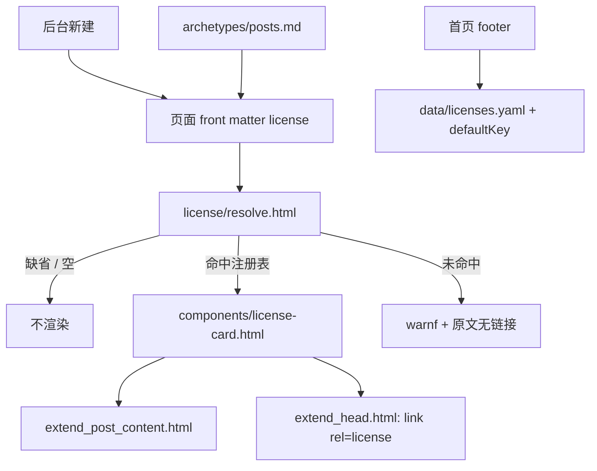

# 文章许可卡片设计（v1）

- 状态：设计已复核，待实施
- 日期：2026-10-31
- 复核：2026-10-31（见第 17 节）
- 仓库：`ZhX-Blog`（Hugo + PaperMod，主题为 submodule）
- 适用范围：文章页许可卡片、首页默认许可声明、后台新建文章默认值

## 1. 背景与目标

给文章增加可选的许可证声明，并在文章正文末尾用卡片展示；新建文章默认带上 `CC-BY-NC-SA 4.0`；未填写 `license` 的旧文章**不显示**许可卡片；首页页脚声明“如无特殊说明，本站使用 CC-BY-NC-SA 4.0 授权”。

目标：

1. 页面级 `license` 是唯一开关：有值才渲染卡片，缺省渲染为空。
2. 新建文章（后台、`hugo new`）默认写入 `license: "CC-BY-NC-SA 4.0"`，但允许改成“不声明”。
3. 首页只做默认声明，不参与文章页的卡片回退。
4. 卡片满足 CC 的 TASL 署名要素（Title、Author、Source、License），并链接到许可 deed。
5. 不修改主题 submodule；全部通过项目层覆盖与新增文件实现。

## 2. 非目标

- 不为缺省 `license` 的文章回填或自动展示默认许可卡片。
- 不在列表页、搜索、RSS 中展示许可卡片。
- 不在 v1 支持双许可（文字 + 代码）、`licenses` taxonomy、JSON-LD 的 `license` 字段。
- 不为“页面（page）”在后台提供许可编辑 UI；页面若手写 `license` 仍可展示。
- 不引入客户端 JavaScript。

## 3. 现状与约束

- PaperMod 没有文章级许可功能；主题里的 `license` 只出现在它自身的 CSS/JS 版权头与 `theme.toml`。
- 主题在 `themes/PaperMod/layouts/single.html` 第 45 行调用 `extend_post_content.html`，位置在 `.Content` 之后、`post-footer`（标签、上一篇/下一篇、分享按钮）之前；主题内该 partial 为空，项目层同名文件可覆盖。
- 主题通过 `partialCached` 缓存 footer（`themes/PaperMod/layouts/baseof.html` 第 28 行），缓存键包含 `.Layout`、`.Kind`、`hideFooter`、`ShowCodeCopyButtons`。首页的 `Kind` 为 `home`，与普通页面不同，因此首页专属声明可以安全地放在 footer 内；**不要**在 footer 里依赖缓存键之外的页面状态（例如当前页是否有 `license`）。
- 后台保存 front matter 时，`assets/admin/js/core.js` 的 `join` 会先写 `FM_ORDER` 已知字段，再追加其余字段；`assets/admin/js/admin.js` 的 `collectEditor` 使用 `Object.assign({}, ed.data)`。因此手写 `license` 不会被后台静默丢弃，但没有 UI 就无法编辑。
- 后台是 Hugo 构建时打包的静态资源（`layouts/admin/admin.html` + `assets/admin/js/*`），改完重新构建即生效。
- CI 使用 Hugo 0.168.0（`.github/workflows/deploy.yml`），主题最低要求 0.146.0；本设计使用的 `return`、`reflect.IsMap`、`replaceRE`、`partialCached` 均受支持。
- 站点为简体中文单语言，作者为 `ZhX589`。

## 4. 决策摘要

| 决策 | 结论 |
|---|---|
| 卡片触发 | 仅当页面显式设置 `license` 且能解析时 |
| 缺省行为 | 不渲染卡片、不占位、不报错 |
| 新建文章默认值 | `license: "CC-BY-NC-SA 4.0"`（后台与 archetype） |
| 首页声明位置 | 现有 footer partial 的 `Kind == "home"` 分支 |
| 首页声明用途 | 站点默认声明，不用于文章页回退 |
| 字段值格式 | 按用户写法 `"CC-BY-NC-SA 4.0"`，匹配时归一化 |
| 许可注册表 | `data/licenses.yaml`，名称/链接/后台选项的唯一来源 |
| 机器可读 | 文章页与首页输出 `<link rel="license">` |
| 主题改动 | 无；不修改 submodule |
| 后台页面级 UI | 仅文章（post）；页面不提供 |

## 5. 语义模型

| 场景 | front matter | 文章页 | 首页 |
|---|---|---|---|
| 新文章（后台 / `hugo new`） | `license: "CC-BY-NC-SA 4.0"` | 渲染卡片 | 声明默认许可 |
| 旧文章 / 手动未写 | 无 `license` | 不渲染 | 声明默认许可 |
| 自定义许可 | 注册表中存在的值 | 按注册表渲染 | 声明默认许可 |
| 手动关闭 | 删除字段 / 后台选“不声明” | 不渲染 | 声明默认许可 |
| 未知值 | 任意未登记字符串 | warning + 原文（无链接） | 声明默认许可 |

需要明确的语义差异：首页声明表示“未另行说明的文章仍受默认许可覆盖”，而文章页只在显式声明时展示卡片。因此“没有卡片”不等于“没有许可”。若未来希望旧文章不受默认许可覆盖，应改首页措辞为“除另有注明外……”，并重新定义缺省语义；v1 不做。

## 6. 数据契约

### 6.1 front matter

```yaml
---
title: "示例文章"
date: 2026-10-31 12:00:00
license: "CC-BY-NC-SA 4.0"
---
```

- 值按用户要求的字面写法保存；允许带空格、连字符、下划线，解析时归一化。
- 缺省、`null`、空字符串：不渲染。
- 不支持 `license: none` 作为特殊值；关闭卡片请删除字段（后台选择“不声明”）。

### 6.2 许可注册表

新增 `data/licenses.yaml`：

```yaml
cc-by-nc-sa-4.0:
  name: "CC-BY-NC-SA 4.0"
  fullName: "Creative Commons Attribution-NonCommercial-ShareAlike 4.0 International"
  url: "https://creativecommons.org/licenses/by-nc-sa/4.0/deed.zh-hans"
  spdx: "CC-BY-NC-SA-4.0"
```

- 键是归一化后的稳定标识；`name` 是卡片与首页展示的短名；`fullName` 用于 `title` 属性；`url` 指向 deed。
- v1 只登记这一条；后续增加 `cc-by-4.0`、`cc0-1.0`、`mit` 等只需追加条目。
- `spdx` 仅作记录与未来导出用，v1 不展示。

### 6.3 归一化规则

对 front matter 值依次执行：

1. `printf "%v"` 转字符串；
2. `lower`；
3. `replaceRE "[ ._]+" "-"`。

于是 `CC-BY-NC-SA 4.0`、`CC BY-NC-SA 4.0`、`cc_by_nc_sa_4.0` 都归一化为 `cc-by-nc-sa-4.0`。

### 6.4 站点默认键

`hugo.toml`：

```toml
[params.license]
defaultKey = "cc-by-nc-sa-4.0"
```

该键只用于首页声明与后台默认值，**不作为文章页卡片的回退**。

## 7. 渲染架构



### 7.1 解析 partial

新增 `layouts/_partials/license/resolve.html`。

接口：输入页面上下文，返回 `false` 或许可条目 map。

```go-html-template
{{- $raw := .Params.license -}}
{{- if not $raw -}}
  {{- return false -}}
{{- end -}}
{{- if reflect.IsMap $raw -}}
  {{- warnf "license 字段应为字符串（页面 %s）" .Path -}}
  {{- return false -}}
{{- end -}}
{{- $value := strings.TrimSpace (printf "%v" $raw) -}}
{{- if eq $value "" -}}
  {{- return false -}}
{{- end -}}
{{- $id := $value | lower | replaceRE `[ ._]+` "-" -}}
{{- $entry := index site.Data.licenses $id -}}
{{- if $entry -}}
  {{- return (dict
    "id" $id
    "raw" $value
    "name" $entry.name
    "fullName" $entry.fullName
    "url" $entry.url
    "spdx" $entry.spdx
  ) -}}
{{- end -}}
{{- warnf "license %q 未在 data/licenses.yaml 中登记（页面 %s）" $value .Path -}}
{{- return (dict "id" $id "raw" $value "name" $value "fullName" $value "url" "") -}}
```

返回字段：

| 字段 | 说明 |
|---|---|
| `id` | 归一化标识 |
| `raw` | 原始 front matter 值 |
| `name` | 展示短名 |
| `fullName` | 全称，用于 `title` |
| `url` | deed 链接；未知值为空 |
| `spdx` | 可选，v1 不展示 |

### 7.2 卡片 partial

新增 `layouts/_partials/components/license-card.html`。

```go-html-template
{{- $page := . -}}
{{- $license := partial "license/resolve.html" $page -}}
{{- with $license -}}
  {{- $author := $page.Params.author | default site.Params.author | default site.Title -}}
  <aside class="license-card" aria-label="许可协议">
    <div class="license-card-title">
      {{ partial "components/icon.html" "license" }}
      <span>许可协议</span>
    </div>
    <p class="license-card-text">
      本文《{{ $page.Title }}》由 {{ $author }} 创作，采用
      {{- if .url }}
      <a rel="license noopener" href="{{ .url }}" target="_blank" title="{{ .fullName | default .name }}">{{ .name }}</a>
      {{- else }}
      <span>{{ .name }}</span>
      {{- end }} 授权。
    </p>
    <p class="license-card-meta">
      <a href="{{ $page.Permalink }}">原文链接</a>
      {{- with .url }} · <a rel="license noopener" href="{{ . }}" target="_blank">查看许可协议</a>{{ end }}
    </p>
  </aside>
{{- end -}}
```

要点：

- 用 `<aside>`，不是整卡链接；卡内有两个目标（原文、许可）。
- `rel="license"` 是机器可读许可声明的关键；`noopener` 与 `target="_blank"` 为外部链接安全/体验。
- 作者优先取页面 `author`，回退站点作者；标题取 `$page.Title`。
- 卡片文案覆盖 TASL：标题、作者、原文链接、许可链接。
- 缺省时 `with` 不输出任何内容，不会留下空 `div` 或 margin。

### 7.3 挂载

新增 `layouts/_partials/extend_post_content.html`：

```go-html-template
{{- partial "components/license-card.html" . -}}
```

位于正文之后、标签/分享之前。

### 7.4 样式

新增 `assets/css/extended/license.css`（`head.html` 会通过 `resources.Match "css/extended/*.css"` 自动打包）：

```css
.license-card {
  margin: 24px 0;
  padding: 20px 24px;
  border: 1px solid var(--border);
  border-radius: 16px;
  background: var(--code-bg);
  color: var(--content);
  font-size: 0.95em;
  line-height: 1.7;
  overflow-wrap: anywhere;
}

:root[data-theme="dark"] .license-card {
  background: #16171a;
}

.license-card-title {
  display: flex;
  align-items: center;
  gap: 8px;
  margin-bottom: 10px;
  color: var(--primary);
  font-weight: 700;
}

.license-card-text {
  margin: 0 0 8px;
}

.license-card-meta {
  margin: 0;
  color: var(--secondary);
  font-size: 0.9em;
}

.license-card a {
  text-underline-offset: 0.25rem;
}

.license-card a:focus-visible {
  outline: 2px solid var(--primary);
  outline-offset: 2px;
}

.footer-license {
  margin: 0 0 6px;
}

@media (max-width: 480px) {
  .license-card {
    padding: 18px;
  }
}

@media print {
  .license-card {
    break-inside: avoid;
  }
}
```

视觉与现有 GitHub 卡片保持一致：相同的边框、圆角、底色与暗色变量，避免引入新的设计语言。

### 7.5 机器可读链接

修改 `layouts/_partials/extend_head.html`：

```go-html-template
{{- $license := partial "license/resolve.html" . -}}
{{- with $license -}}
  {{- with .url }}<link rel="license" href="{{ . }}">{{ end -}}
{{- end -}}
{{- if .IsHome -}}
  {{- with site.Params.license -}}
    {{- with .defaultKey -}}
      {{- with index site.Data.licenses . }}<link rel="license" href="{{ .url }}">{{ end -}}
    {{- end -}}
  {{- end -}}
{{- end -}}
```

`head.html` 不是缓存 partial，按页面输出安全。

## 8. 首页声明

修改项目已有的 `layouts/_partials/footer.html`，在版权行之前加入：

```go-html-template
{{- if eq .Kind "home" -}}
  {{- with site.Params.license -}}
    {{- with .defaultKey -}}
      {{- with index site.Data.licenses . -}}
<p class="footer-license">如无特殊说明，本站使用 <a rel="license" href="{{ .url }}" title="{{ .fullName | default .name }}">{{ .name }}</a> 授权。</p>
      {{- end -}}
    {{- end -}}
  {{- end -}}
{{- end -}}
```

要点：

- 只对首页生效；其他页面仍显示原有页脚。
- 缓存安全：footer 的缓存键包含 `.Kind`，首页与普通页面不会互相污染。
- 不要在这里判断 `.Params.license`；`license` 不在缓存键中，会串页。如果以后要全站显示这句话，直接去掉 `if`，保持无条件输出。
- 文案与首页其他内容风格一致；链接到 deed，并带 `fullName` 的 `title`。
- 对应 CSS 见 7.4 的 `.footer-license`。

若希望声明更醒目（个人资料按钮下方），替代方案是复制主题的 `themes/PaperMod/layouts/_partials/index_profile.html` 到项目层并在按钮后插入一行；代价是 58 行主题副本需要随上游升级合并。v1 不采用。

## 9. 新建文章默认值

### 9.1 后台（主入口）

修改 `assets/admin/js/admin.js`：

1. 新建文章的初始 `data` 增加许可：

```js
license: (window.ADMIN_CONFIG && window.ADMIN_CONFIG.licenseDefault) || ''
```

2. 新增选项生成函数：

```js
function licenseOptions(current) {
  var cfg = window.ADMIN_CONFIG || {};
  var items = cfg.licenses || [];
  var names = items.map(function (item) { return item.name; });
  var options = [{ value: '', label: '不声明（不展示卡片）' }];

  items.forEach(function (item) {
    options.push({ value: item.name, label: item.name });
  });

  if (current && names.indexOf(current) < 0) {
    options.push({ value: current, label: current + '（自定义）' });
  }

  return options.map(function (item) {
    return '<option value="' + esc(item.value) + '"' +
      (item.value === current ? ' selected' : '') + '>' + esc(item.label) + '</option>';
  }).join('');
}
```

3. `editorHtml` 的文章分支，在分类字段后增加：

```js
meta += '<label class="admin-field">许可协议' +
  '<select id="f-license" class="admin-select">' + licenseOptions(data.license) + '</select>' +
  '<span class="admin-hint">留空则文章页不显示许可卡片</span>' +
  '</label>';
```

4. `bindEditor` 中为 select 绑定 dirty 标记（表单的 `input` 监听对 select 已生效，但 `change` 更稳）：

```js
var licenseSelect = $('#f-license');
if (licenseSelect) licenseSelect.addEventListener('change', markDirty);
```

5. `collectEditor` 的文章分支：

```js
var licenseSelect = $('#f-license');
if (licenseSelect) {
  var license = licenseSelect.value.trim();
  if (license) data.license = license;
  else delete data.license;
}
```

行为：

- 新建：默认选中 `CC-BY-NC-SA 4.0`。
- 旧文章：默认选中“不声明”，保存不会新增字段。
- 自定义当前值不在选项：追加“自定义”选项，保存不丢值。
- 选择“不声明”：删除字段，文章页不渲染卡片。
- 页面（page）没有 select，`collectEditor` 不触碰 `license`，手写值原样保留。

### 9.2 注入后台配置

修改 `layouts/admin/admin.html`，在构造 `$cfg` 前计算：

```go-html-template
{{- $licenses := slice -}}
{{- range $key, $value := site.Data.licenses -}}
  {{- $licenses = $licenses | append (dict "key" $key "name" $value.name) -}}
{{- end -}}
{{- $defaultLicense := "" -}}
{{- with site.Params.license -}}
  {{- with .defaultKey -}}
    {{- with index site.Data.licenses . -}}{{- $defaultLicense = .name -}}{{- end -}}
  {{- end -}}
{{- end -}}
```

然后加入 `$cfg`：

```go-html-template
"licenses" $licenses
"licenseDefault" $defaultLicense
```

这样许可列表与默认值只有 `data/licenses.yaml` 和 `hugo.toml` 两个来源，后台不另外维护一份。

### 9.3 `hugo new`

新增 `archetypes/posts.md`（保留 `archetypes/default.md` 不动，避免新建页面也带许可）：

```yaml
---
date: '{{ .Date }}'
draft: true
title: '{{ replace .File.ContentBaseName "-" " " | title }}'
license: "CC-BY-NC-SA 4.0"
---
```

Hugo 对 `content/posts/...` 会优先匹配 `archetypes/posts.md`。

### 9.4 序列化顺序

修改 `assets/admin/js/core.js` 的 `FM_ORDER`，在 `description` 后加入 `license`：

```js
var FM_ORDER = ['title', 'date', 'description', 'license', 'categories', 'tags', 'draft', 'lastmod', 'slug', 'menu', 'weight', 'params'];
```

即使不加也能保存（未知字段追加到末尾），加上只是让 front matter 顺序稳定、可读。

## 10. 文件级改动清单

| 文件 | 类型 | 内容 | 依赖 |
|---|---|---|---|
| `data/licenses.yaml` | 新增 | 许可注册表 | 无 |
| `hugo.toml` | 修改 | `[params.license] defaultKey` | 无 |
| `layouts/_partials/license/resolve.html` | 新增 | 归一化、查表、回退 | 数据文件 |
| `layouts/_partials/components/license-card.html` | 新增 | 卡片结构 | resolver、图标 |
| `layouts/_partials/extend_post_content.html` | 新增 | 挂载卡片 | 卡片 partial |
| `assets/css/extended/license.css` | 新增 | 卡片与页脚声明样式 | 无 |
| `layouts/_partials/extend_head.html` | 修改 | `<link rel="license">` | resolver、数据文件 |
| `layouts/_partials/footer.html` | 修改 | 首页声明 | 数据文件、配置 |
| `archetypes/posts.md` | 新增 | 新文章默认许可 | 无 |
| `assets/admin/js/admin.js` | 修改 | 新建默认值、下拉、保存 | `ADMIN_CONFIG` |
| `assets/admin/js/core.js` | 修改 | `FM_ORDER` | 无 |
| `layouts/admin/admin.html` | 修改 | 注入许可列表与默认值 | 数据文件、配置 |

不改动 `themes/PaperMod/**`。

## 11. 可访问性与 SEO

- `<aside aria-label="许可协议">` 提供区域语义；图标本身 `aria-hidden`。
- 许可链接文本可读，不使用“点击这里”。
- `rel="license"` 同时出现在卡片与 `<head>`；CC 4.0 要求提供许可链接。
- `title` 放 CC 全称，便于悬停查看。
- 暗色模式沿用现有变量，对比度与 GitHub 卡片一致。
- 打印时避免卡片跨页断开。
- RSS 不包含卡片：`extend_post_content` 不进入 `.Content`；搜索索引同理。

## 12. 后台交互细节

- 新建文章：初始 `license` 来自 `ADMIN_CONFIG.licenseDefault`；若配置为空，则为空字符串，select 显示“不声明”。
- 打开已有文章：select 选中当前值；当前值不在注册表时追加自定义项。
- 保存草稿与发布：都走 `collectEditor`，许可证字段行为一致。
- 失败场景：若 `site.Data.licenses` 缺失，`licenseOptions` 只有“不声明”，新建文章不带默认值；构建不失败。
- 页面编辑：无许可控件，`license` 字段原样保留。
- 预览 iframe 只渲染 Markdown，不显示许可卡片；这是预期行为，不需要在后台复制卡片样式。

## 13. 边界与风险

1. **语义不对称**：缺省不展示卡片，但首页声明覆盖默认许可。需要在文案上接受“没有卡片 ≠ 没有许可”。若不能接受，需改首页措辞并重新定义缺省。
2. **旧文章不回填**：符合“缺省不要求”；但站点上会同时存在有卡片和无卡片的文章，属于显式声明差异。
3. **未知许可值**：构建产生 warning，页面显示原文且无链接，不中断部署。若希望更严格，可改为 `errorf`，但一个手写 typo 会卡住部署。
4. **注册表改名**：只改 `name` 不影响旧 front matter（归一化基于标识）；改 map key 会失配，需要迁移。
5. **后台自定义值**：下拉必须保留未知当前值，否则保存会静默改写手写字段。
6. **footer 缓存**：声明只能依赖缓存键内的状态；不要按当前页 `license` 分支。若改为全站声明，建议无条件输出。
7. **第三方内容**：引用段落、截图、转载图不自动适用本站许可；必要时在卡片文案中加“文中引用内容除外”。
8. **CC 名称写法**：front matter 使用用户要求的连字符写法，展示名也取同一字符串；如需更贴近 CC 官方写法，只改数据文件的 `name`，不改 front matter。
9. **卡片位置**：在标签/分享按钮之前；若要放到之后，只能覆盖 `single.html`，接受主题升级合并成本。
10. **多许可**：v1 一个页面一个许可；双许可（文字 CC + 代码 MIT）需要把 `license` 扩展为列表，卡片渲染多行，属于 v2。

## 14. 验收清单

构建与页面：

1. `hugo --gc --minify` 成功，无模板错误。
2. 给一篇测试文章加 `license: "CC-BY-NC-SA 4.0"`：正文后出现卡片，位于标签之前；链接可点；暗色/移动端正常。
3. 同一篇删除 `license`：卡片完全消失，无空 margin。
4. 手写 `license: "CC BY-NC-SA 4.0"` 或 `cc_by_nc_sa_4.0`：同样命中注册表。
5. 手写未登记值：构建 warning，页面显示原文且无链接。
6. 文章页源码包含 `<link rel="license" href="...deed.zh-hans">`。
7. 首页页脚出现“如无特殊说明，本站使用 CC-BY-NC-SA 4.0 授权。”，链接正确；其他页面不出现。
8. 首页源码包含 `<link rel="license">`。
9. RSS 与列表页不包含卡片。

后台：

10. 新建文章：front matter 自动包含 `license: "CC-BY-NC-SA 4.0"`。
11. 选择“不声明”保存：字段被删除；再次打开显示“不声明”。
12. 手写自定义许可后进后台再保存：字段不被改写，select 显示“自定义”。
13. 页面编辑：不会新增或删除 `license`。

## 15. 实施顺序

1. 数据与前台：`data/licenses.yaml`、resolver、卡片、`extend_post_content`、CSS；用一篇测试文章验证。
2. 首页与机器可读：`params.license.defaultKey`、footer 首页声明、`extend_head` 链接。
3. 新建入口：`archetypes/posts.md`、后台初始化/下拉/保存、`FM_ORDER`、后台配置注入。
4. 全量构建与后台端到端验证；更新验收记录。

## 16. 后续扩展（不在 v1）

- **双许可**：`license` 支持列表，卡片多行渲染；需要同时调整 resolver、卡片、后台下拉。
- **`licenses` taxonomy**：支持按许可证浏览文章；需要 term 标题映射与归档页样式。
- **JSON-LD**：在 `extend_head` 输出 `BlogPosting.license`，或扩展主题的 schema partial。
- **RSS**：自定义 RSS 模板，在 item 中带 `<copyright>` 或 `<link rel="license">`。
- **页面级后台 UI**：若 `about` 等页面也需要许可，可把 select 扩展到 page。
- **许可变更记录**：若担心历史许可声明，可在 front matter 记录 `licenseSince` 或在文末注明变更；v1 不处理。

## 17. 设计复核记录

复核时间：2026-10-31。复核方式：只读检查主题、项目布局与后台源码，没有执行构建；模板语法需在实施时用 Hugo 实测确认。

已核实的事实：

- `themes/PaperMod/layouts/single.html` 第 45 行调用 `extend_post_content.html`；主题内该 partial 只有注释，项目层可覆盖。
- `themes/PaperMod/layouts/baseof.html` 第 28 行用 `partialCached` 渲染 footer，缓存键包含 `.Layout`、`.Kind`、`hideFooter`、`ShowCodeCopyButtons`，首页与普通页面不会共用缓存。
- `assets/admin/js/core.js` 第 14 行是 `FM_ORDER`；第 40–63 行的 `join` 会把不在 `FM_ORDER` 的字段追加到末尾；`admin.js` 第 1049 行 `collectEditor` 使用 `Object.assign({}, ed.data)`，未知字段可保留。
- `assets/admin/js/admin.js` 已提供 `$`、`$all`、`esc`（第 35–38 行）；`assets/admin/admin.css` 已提供 `.admin-select`、`.admin-hint` 样式，后台下拉与提示可直接复用。
- `themes/PaperMod/layouts/_partials/head.html` 第 59 行通过 `resources.Match "css/extended/*.css"` 自动打包扩展样式，新增 `license.css` 无需改主题。

复核后对文档做的修正：

1. **空值判断**：原示例 `or (not $raw) (eq $raw "")` 在 `$raw` 为 nil 时可能触发 `eq` 的类型比较问题；改为先用 `not $raw` 返回，再 `strings.TrimSpace` 后判断空字符串。
2. **参数缺失保护**：`site.Params.license.defaultKey` 在未配置 `[params.license]` 时存在 nil 链式访问风险；head、footer、admin 三处都改为逐层 `with`。
3. **返回值构造**：resolver 命中时改用显式 `dict`，不再依赖 `merge` 的覆盖顺序，返回字段更可预测。
4. **后台提示**：许可下拉增加 `.admin-hint` 提示“留空则文章页不显示许可卡片”。

残留事项（实施时确认）：

- 未知许可值会在 `extend_head` 与卡片两处各触发一次 `warnf`，属于可接受的重复警告；若介意，可让 resolver 使用 `partialCached` 按页面缓存，或只在一处解析后传递结果。
- `license` 若被写成 YAML 对象（map），当前设计只警告并跳过；v1 不支持对象形式。
- 文档未执行 `hugo` 构建；验收清单中的构建与后台测试需要在实施阶段完成。
- 本文件是设计规格，未改动任何代码、配置或主题文件。
